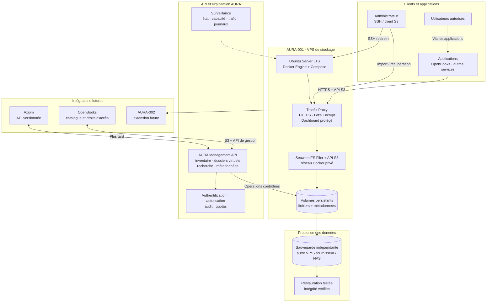

# AURA Storage — Architecture

Ce diagramme représente la cible initiale : un VPS autonome, Docker Compose, Traefik pour le reverse proxy et TLS, SeaweedFS pour le stockage objet et une API AURA pour les opérations de gestion.

## Règles d'architecture

- **Traefik** : routage HTTP/HTTPS, certificats TLS automatisés, journaux et métriques. Son dashboard est une interface d'observation, pas une console de gestion des fichiers ; il doit rester protégé.
- **SeaweedFS** : stockage des objets et interface S3. Les ports internes et les interfaces d'administration ne sont pas publiés directement sur Internet.
- **API AURA** : couche à développer pour cartographier les objets, maintenir les métadonnées, exposer une arborescence logique, rechercher et appliquer les permissions. Elle ne doit pas dépendre de l'interface Traefik.
- **Volumes persistants** : les données survivent au remplacement des conteneurs. Ils ne remplacent pas une sauvegarde indépendante.
- **Sauvegarde** : destination distincte et restauration testée avant l'import des données importantes.
- **Périmètre MVP** : un VPS n'est pas de la haute disponibilité. La réplication multi-serveurs sera une évolution séparée.
- **Statut** : cible d'architecture ; configuration, commandes et politiques SeaweedFS doivent être testées avec les versions retenues avant production.
