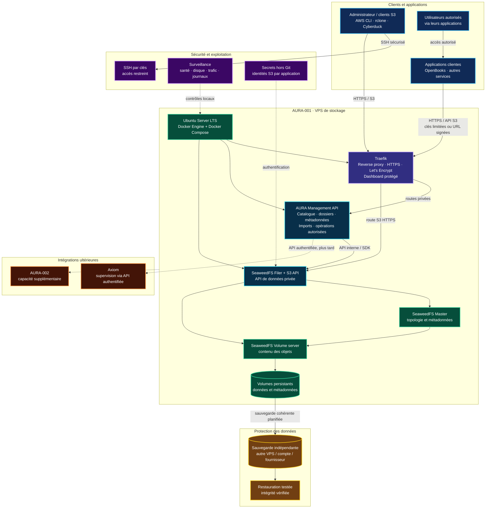

# AURA Storage — Architecture Diagram

This color-coded Mermaid diagram describes the intended initial single-node MVP. It is a target architecture, not a claim that the VPS has already been provisioned or that all services have been tested.

## Color legend

- **Blue:** clients and applications.
- **Purple:** Traefik reverse proxy and operations/security controls.
- **Cyan:** APIs.
- **Green:** storage engine and persistent data.
- **Yellow:** independent backup and restore.
- **Orange:** future integrations and expansion.

Traefik handles HTTPS routing and certificate automation. Its dashboard must be protected. SeaweedFS internal ports remain private. The AURA Management API is a separate planned component for catalogue, logical folders, metadata and import jobs; its implementation and contract still need to be built and tested. A single VPS is not high availability.
