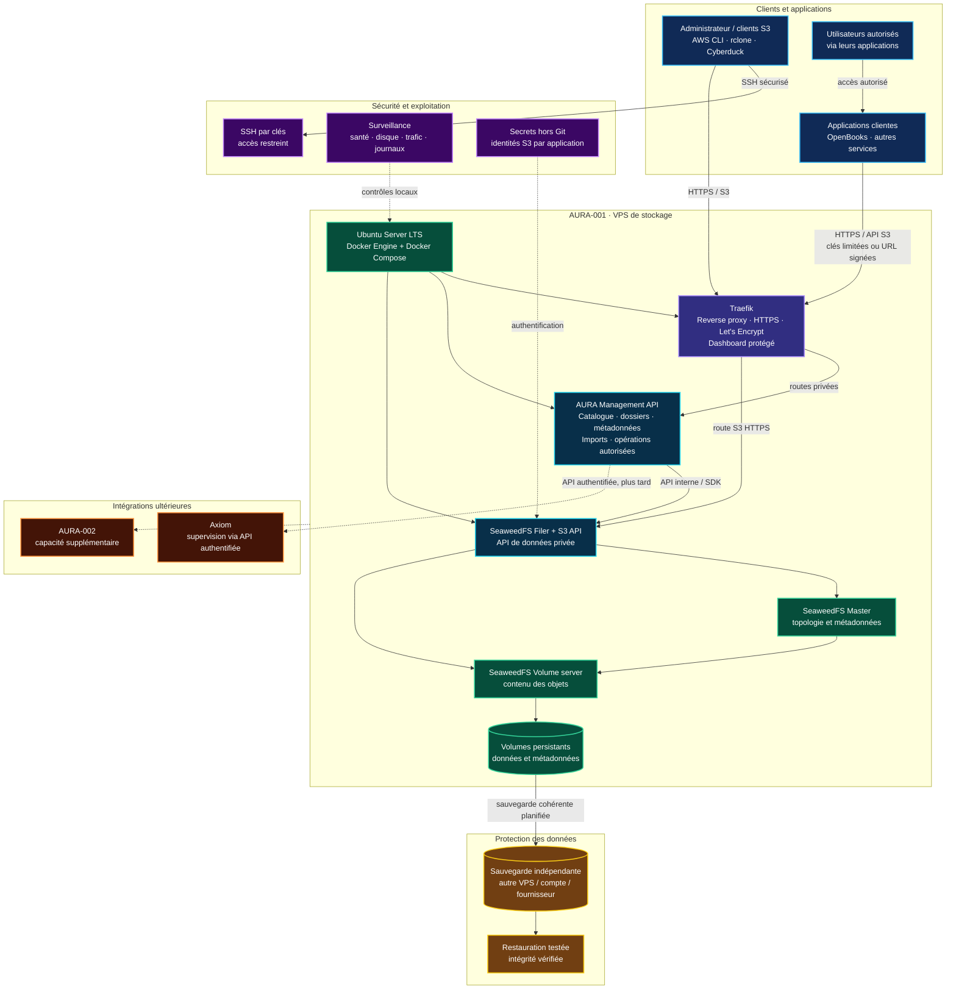

# AURA Storage Architecture

AURA is an independent storage data plane. Its first deployment is a single VPS; this is not high availability.

## Target topology

## Components and responsibilities

- **Docker Engine + Compose:** reproducible service lifecycle on AURA-001.
- **Traefik:** public HTTPS edge, routing and automatic certificate management. Protect its dashboard with authentication and network restrictions; never expose it as an unauthenticated public admin interface.
- **SeaweedFS Filer + S3 API:** object data interface, namespace and metadata services. Internal service ports must not be exposed publicly.
- **AURA Management API:** a separate application API for cataloguing objects, browsing logical folders, recording import jobs, and authorising management operations. It is not implemented by this diagram alone; define and test its contract before deployment.
- **Persistent volumes:** durable data and metadata on the host filesystem, with capacity verified after provisioning.
- **Independent backup:** a different failure domain, with a tested restore process.
- **Axiom:** later integration through a restricted, authenticated management API. Normal S3 traffic must not depend on Axiom.

## Two API surfaces

1. **S3 data API:** applications and approved tools upload, list, download and delete objects according to credentials/policy.
2. **AURA Management API:** authenticated catalogue/search, logical folder views, object metadata, import-job status, and controlled actions. Keep it separate from unrestricted storage administration.

For folder mapping, do not assume an object store has physical directories. Define logical folder prefixes and metadata, then keep stable object keys/IDs in the catalogue. Ensure listing and deletion operations are permission-checked and auditable.

## Deployment and security requirements

- Install Docker on the provisioned Ubuntu LTS server, then deploy Traefik and the storage stack with reviewed Compose configuration.
- Only required public ports should be open (normally 80/443 for HTTP challenge/redirect and HTTPS, plus SSH restricted as practical).
- Keep SeaweedFS master, volume, filer and administrative ports private.
- Store secrets outside Git; use separate least-privilege S3 identities per application.
- Validate SeaweedFS flags, S3 policy syntax, health checks, TLS routing, upload/download, large objects, Range requests and persistence against the exact pinned release.
- Do not load important content until an independent backup and a successful restore test are verified.

## Limitation

One VPS remains a single point of failure. Add nodes only after the single-node setup, monitoring, backups and restore process are reliable.
