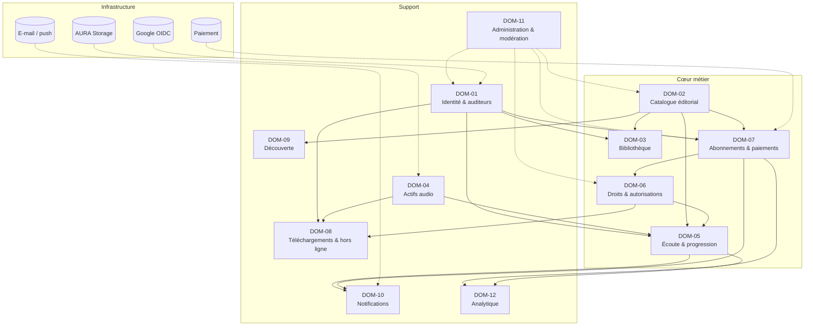

# 01 — Cartographie des domaines métier

**Objectif :** délimiter les responsabilités, les dépendances et les frontières
du backend de livres audio. Aucun domaine ne doit devenir le propriétaire
implicite des données d'un autre.

---

## 1. Vue d'ensemble

Le système cible est composé de **12 domaines métier** et de **4 capacités
techniques génériques**.

### 1.1 Domaines métier

| ID | Domaine | Type | Responsabilité principale | Ne possède pas |
|---|---|---|---|---|
| DOM-01 | Identité et auditeurs | Support | Compte, profil, préférences, sessions, appareils, consentements | Les droits d'accès, la bibliothèque, les achats |
| DOM-02 | Catalogue éditorial | **Cœur** | Œuvres, éditions, enregistrements, contributeurs, chapitres, catégories, collections éditoriales, publication | Les fichiers, les droits de diffusion, les prix |
| DOM-03 | Bibliothèque personnelle | **Cœur** | Entrées de bibliothèque, favoris, collections privées, imports personnels | La propriété commerciale ou le droit d'écoute |
| DOM-04 | Actifs audio | **Cœur** | Fichiers sources et dérivés, validation, intégrité, disponibilité technique, remplacement | La validation éditoriale, les droits, la vente |
| DOM-05 | Écoute et progression | **Cœur** | Sessions d'écoute, événements, progression courante, reprise, complétion, synchronisation | L'autorisation d'accès, les statistiques commerciales |
| DOM-06 | Droits et autorisations | **Cœur** | Licences, fenêtres de droits, territoires, décisions d'accès, entitlements | Les paiements, le catalogue, la diffusion technique |
| DOM-07 | Abonnements et paiements | **Cœur** | Offres, commandes, paiements, factures, remboursements, abonnements, grand livre | L'accès lui-même (il produit des droits) |
| DOM-08 | Téléchargements et hors ligne | Support | Grants de téléchargement, leases, appareils, synchronisation hors ligne | Les droits (il les consomme) |
| DOM-09 | Découverte et recommandations | Support | Recherche, filtres, classement, suggestions | Le catalogue (il l'indexe) |
| DOM-10 | Notifications | Support | Événements, préférences, envoi, historique | Les décisions métier |
| DOM-11 | Administration et modération | Support/contrôle | Workflows éditoriaux, supervision, modération, actions sensibles, audit | Les données privées des auditeurs |
| DOM-12 | Statistiques et analytique | Support | Faits d'écoute, agrégats, indicateurs produit et commerciaux | Les événements sources (ils sont émis par les autres domaines) |

### 1.2 Capacités techniques génériques

| Capacité | Rôle | Fournisseur recommandé |
|---|---|---|
| Stockage binaire | Conserver et diffuser les octets | AURA Storage (S3/SeaweedFS) |
| Identité fédérée | Vérifier une identité externe | Google OIDC, puis magic link e-mail |
| Paiement | Encaisser, rembourser, webhooks | Stripe (à confirmer) |
| Messagerie | E-mail, push, in-app | Fournisseur à choisir |

Ces capacités sont **derrière des ports** (`StoragePort`, `IdentityProviderPort`,
`PaymentProviderPort`, `NotificationPort`). Aucun domaine ne doit importer
directement le SDK d'un fournisseur.

---

## 2. Carte des contextes



**Lecture :** les flèches pleines sont des dépendances de lecture/validation ;
les pointillés sont des relations de contrôle administratif. L'administration
n'est pas une dépendance métier des agrégats : elle passe par des commandes
explicites et auditées.

---

## 3. Règles de dépendance

1. **Identité est amont de tout.** Aucun domaine ne crée un auditeur ou une
   session à la place de DOM-01.
2. **Catalogue est amont de la bibliothèque, de l'écoute, de la découverte et de
   la vente.** Un achat référence une édition ou un produit, jamais un fichier
   brut.
3. **Les actifs audio sont amont de la lecture et du téléchargement.** Un
   catalogue peut être éditorialement valide alors que l'actif est indisponible.
4. **Les droits sont amont de l'autorisation.** Un achat ou un abonnement ne
   suffit pas si la fenêtre de droits est fermée ou le territoire interdit.
5. **Le paiement est amont de l'entitlement, pas l'inverse.** Un paiement en
   attente ne crée jamais d'accès.
6. **L'écoute est aval de l'autorisation.** Aucun événement de lecture ne doit
   être accepté pour une ressource non autorisée, sauf pour enregistrer un
   refus (audit).
7. **L'analytique est aval des faits.** Elle ne doit jamais être la source de
   vérité d'un droit, d'un paiement ou d'une progression.
8. **Les notifications sont aval des transitions confirmées.** On notifie
   `payment.succeeded`, jamais `payment.initiated`.
9. **Aucun cycle entre domaines.** Si un cycle apparaît, il est cassé par un
   événement asynchrone ou une projection.
10. **Aucune lecture croisée de tables.** Un domaine expose des commandes et des
    requêtes ; il ne laisse pas un autre domaine écrire dans ses tables.

---

## 4. Dépendances détaillées et contrats

### 4.1 DOM-01 → autres domaines

**Expose :**
- `resoudre_auditeur(identity_provider, subject)` → auditeur ;
- `verifier_session(token)` → principal ;
- `statut_compte(auditeur_id)` → actif/suspendu/bloqué/en suppression ;
- `appareils_actifs(auditeur_id)`.

**Consomme :** rien (sauf audit et notifications pour les événements de sécurité).

**Événements émis :** `listener.created`, `listener.suspended`,
`listener.reactivated`, `listener.deletion_requested`, `listener.deleted`,
`listener.email_changed`, `device.registered`, `device.revoked`.

### 4.2 DOM-02 → bibliothèque, écoute, découverte, commerce

**Expose :**
- `resoudre_edition(edition_id)` → métadonnées publiques + statut ;
- `resoudre_work(work_id)` → métadonnées ;
- `est_publiable(edition_id)` → liste de blockers ;
- `catalogue_public(filtres)` → projections de découverte ;
- `chapitres(edition_id)` → structure ordonnée.

**Consomme :** actifs audio (disponibilité), droits (publication), administration
(validation éditoriale).

**Événements émis :** `work.created`, `edition.published`,
`edition.suspended`, `edition.retired`, `metadata.updated`.

### 4.3 DOM-03 → écoute, découverte

**Expose :** `bibliotheque(auditeur_id)`, `est_dans_bibliotheque(...)`,
`collections_privees(...)`.

**Consomme :** catalogue (références), identité, actifs (disponibilité),
autorisations (pour afficher « disponible/indisponible », pas pour autoriser).

**Événements émis :** `library.entry_added`, `library.entry_removed`,
`favorite.toggled`, `personal_collection.deleted`, `personal_import.created`.

### 4.4 DOM-04 → écoute, téléchargement, catalogue

**Expose :** `actif_pret(asset_id)`, `manifeste_lecture(edition_id)`,
`url_lecture(asset_id, ttl)`, `etat_integrite(asset_id)`.

**Consomme :** AURA Storage (octets), catalogue (rattachement), administration
(validation), antivirus/ffprobe (contrôles techniques).

**Événements émis :** `asset.uploaded`, `asset.validation_failed`,
`asset.ready`, `asset.superseded`, `asset.blocked`, `asset.deleted`.

### 4.5 DOM-05 → analytique, notifications

**Expose :** `progression_courante(auditeur, edition)`,
`historique_ecoute(auditeur, edition)`, `statut_completion(...)`.

**Consomme :** identité, catalogue, autorisations, actifs.

**Événements émis :** `listening.session_started`, `listening.progressed`,
`listening.seeked`, `listening.completed`, `listening.session_stale`,
`listening.sync_conflict`.

### 4.6 DOM-06 → écoute, téléchargement

**Expose :**
- `decision_acces(auditeur, ressource, action, contexte)` →
  `allow|deny`, raison, date d'expiration, sources ;
- `entitlements_actifs(auditeur)`.

**Consomme :** identité (statut), catalogue (édition), droits (fenêtres),
paiements/abonnements (sources), actifs (disponibilité).

**Événements émis :** `access.granted`, `access.denied`,
`entitlement.created`, `entitlement.revoked`, `entitlement.expired`.

### 4.7 DOM-07 → droits

**Expose :** `sources_actives(auditeur)`, `abonnement_courant(auditeur)`,
`achats(auditeur)`, `facture(...)`.

**Consomme :** identité, catalogue (produits), prestataire de paiement.

**Événements émis :** `order.created`, `payment.succeeded`, `payment.failed`,
`subscription.activated`, `subscription.renewed`, `subscription.past_due`,
`subscription.expired`, `refund.completed`, `chargeback.opened`.

### 4.8 DOM-08 → écoute

**Expose :** `grant_telechargement(...)`, `lease_hors_ligne(...)`.

**Consomme :** identité, droits, actifs, appareils.

**Événements émis :** `download.granted`, `download.completed`,
`download.expired`, `offline.lease_renewed`, `offline.lease_denied`.

### 4.9 DOM-09 → aucun domaine métier (lecture seule)

**Expose :** résultats de recherche et suggestions.
**Consomme :** catalogue, bibliothèque (signaux privés), analytique (popularité
agrégée), autorisations (pour marquer « accessible » sans exposer de données
privées).

### 4.10 DOM-10 → aucun domaine métier

**Consomme :** événements confirmés de tous les domaines.
**Expose :** préférences et historique de notification.

### 4.11 DOM-11 → tous les domaines, via commandes

**Expose :** workflows, files de validation, modération, actions sensibles.
**Consomme :** lecture des projections administratives, jamais les octets
personnels par défaut.

### 4.12 DOM-12 → aucun domaine métier

**Consomme :** événements et projections.
**Expose :** agrégats, tableaux de bord, exports.

---

## 5. Frontières avec AURA Storage

### 5.1 Ce qu'AURA possède

- Les octets et leur emplacement ;
- les checksums, tailles, types MIME, chiffrement au repos ;
- le cycle de vie des objets (pending, available, failed, deleted, purged) ;
- les URLs présignées de courte durée ;
- l'audit des accès de service ;
- les quotas d'espace ;
- HLS et sous-titres.

### 5.2 Ce que le domaine audiobook possède

- La signification éditoriale d'un fichier (œuvre, édition, piste, chapitre) ;
- la validation métier d'un actif (format attendu, durée, qualité, droits) ;
- la décision de publication ;
- la décision d'accès ;
- les droits, achats, abonnements ;
- la progression et l'historique ;
- les appareils et leases hors ligne.

### 5.3 Anti-corruption layer

```
Audiobook Domain
   └── StoragePort (interface)
         └── AuraStorageAdapter
               ├── POST /api/v1/objects/upload-intents
               ├── POST /api/v1/objects/{oid}/commit
               ├── POST /api/v1/objects/{oid}/download-intent
               ├── PUT  /api/v1/objects/{oid}/publication   (previews uniquement)
               └── GET  /api/v1/objects/{oid}
```

**Règles :**
- l'identité de service AURA est dédiée à l'environnement (dev/staging/prod) ;
- scopes minimaux : `objects:read`, `objects:write` ; `objects:purge` jamais ;
- aucun identifiant AURA (`object_id`, `bucket`, `object_key`) n'est exposé au
  client audiobook ;
- l'API audiobook ne relaie jamais un payload S3 brut ;
- chaque appel porte un `request_id` corrélé à la décision d'accès ;
- une panne AURA est traduite en erreur métier (`ASSET_UNAVAILABLE`,
  `STORAGE_DEGRADED`), jamais en 500 générique non tracé.

### 5.4 Sort de `/m/{slug}`

| Usage | Autorisé ? | Règle |
|---|---|---|
| Preview gratuite d'un livre | Oui, avec réserve | Objet dédié, TTL court, aucun contenu payant |
| Livre acheté | **Non** | Passe par `POST /playback/{edition}/authorize` → URL AURA courte |
| Livre d'abonnement | **Non** | Idem, avec vérification de la fenêtre de droits |
| Téléchargement hors ligne | **Non** | Grant lié à l'appareil, URL et lease dédiés |
| Contenu personnel importé | **Non** | Jamais publié, jamais de slug public |

**À retenir :** un slug est un identifiant, pas une autorisation.

---

## 6. Correspondance avec l'existant

| Cible | Existant | Action recommandée |
|---|---|---|
| `listener` | `users` (rôle `public`, OAuth) | Nouvelle table/domaine ; migrer par `oauth_sub`, ne pas réutiliser `users` |
| `work` / `edition` | `collections` (pack) + `objects` | Nouveau modèle ; les packs deviennent des collections éditoriales ou des éditions après nettoyage |
| `track` / `chapter` | `objects` + `audio_chapters` | Nouveau modèle ; `objects` reste l'actif de stockage |
| `asset` | `objects` | Conserver AURA comme stockage ; ajouter `asset` métier qui référence l'objet |
| `library_entry` | Absent | Nouveau |
| `entitlement` | Absent ; `published_at` fait office de gate | Nouveau ; retirer le gate de publication |
| `listening_event` | Absent ; `listen_progress` LWW | Nouveau journal + projection ; migrer les positions existantes |
| `subscription`, `payment` | Absent | Nouveau |
| `download_grant` | `download-intent` AURA | Nouveau grant métier au-dessus |
| `admin` éditorial | Administration AURA des objets | Nouveau workflow, rôles séparés |
| `analytics` | Compteurs objet | Nouveaux faits d'écoute et agrégats |

---

## 7. Ordre de construction recommandé

1. **Fondations** : identité auditeur, catalogue, actifs, bibliothèque.
2. **Cœur d'expérience** : autorisation (avec politique gratuite), écoute,
   progression, synchronisation.
3. **Commercialisation** : offres, abonnements, paiements, achats, remboursements.
4. **Expérience avancée** : hors ligne, découverte, notifications, analytique.
5. **Exploitation avancée** : administration riche, modération, optimisation,
   résilience.

Cet ordre n'est pas négociable dans ses dépendances : on ne construit pas un
abonnement avant de savoir accorder et vérifier un droit ; on ne construit pas
une synchronisation avant d'avoir un journal d'événements.
