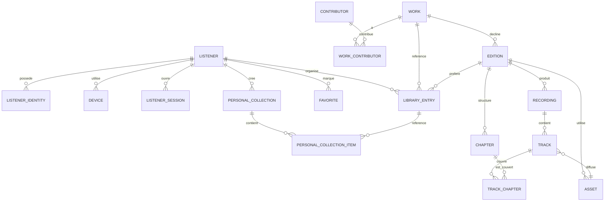
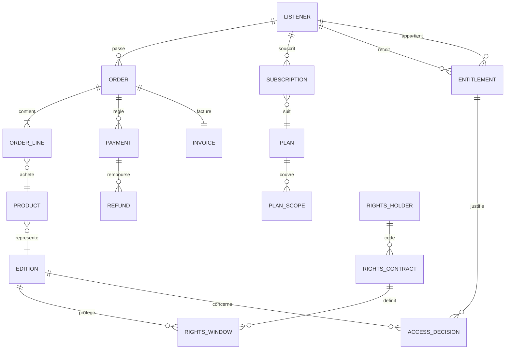
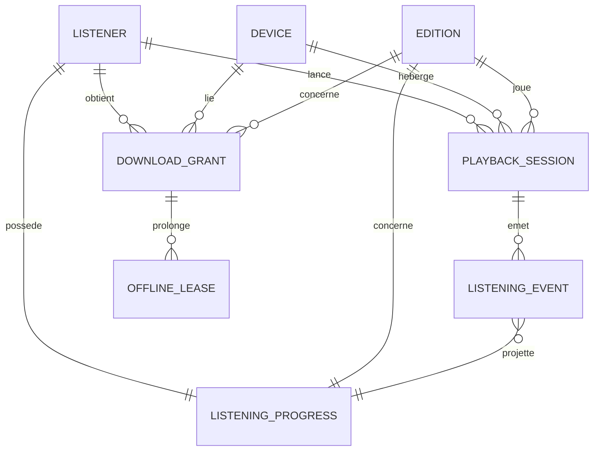

# 02 — Modèle de domaine

**Objectif :** définir les concepts, les agrégats, les relations et les règles
d'identité du domaine audiobook. Ce document est volontairement indépendant du
schéma SQL final : il fixe le langage commun avant les tables.

---

## 1. Dictionnaire des concepts

> Règle : un concept = un mot = une responsabilité. Les mots ambigus (« livre »,
> « fichier », « accès ») sont interdits dans le code du domaine.

| Terme | Définition | Ne pas confondre avec | Nom technique |
|---|---|---|---|
| **Œuvre** | Création intellectuelle indépendante de ses éditions | Édition, fichier | `work` |
| **Édition** | Version publiée d'une œuvre : langue, éditeur, présentation, durée | Enregistrement, piste | `edition` |
| **Enregistrement** | Production audio d'une édition (studio, année, distribution) | Fichier source | `recording` |
| **Piste** | Unité audio livrée (fichier ou segment HLS) rattachée à un enregistrement | Chapitre | `track` |
| **Chapitre** | Division éditoriale ordonnée, avec titre et bornes temporelles | Piste | `chapter` |
| **Actif audio** | Objet binaire stocké (source ou dérivé), avec checksum et état technique | Piste, édition | `asset` |
| **Contributeur** | Personne ou organisation ayant un rôle (auteur, narrateur, traducteur…) | Utilisateur | `contributor` |
| **Collection éditoriale** | Sélection curatée d'éditions, gérée par l'administration | Bibliothèque personnelle | `editorial_collection` |
| **Produit** | Objet commercialisable (édition, bundle, offre) | Édition | `product` |
| **Prix** | Montant dans une devise et un contexte fiscal | Produit | `price` |
| **Offre / plan** | Ensemble de droits et conditions commerciales (abonnement) | Abonnement | `plan` |
| **Abonnement** | Engagement d'un auditeur sur un plan, avec périodes | Droit d'accès | `subscription` |
| **Commande** | Intention d'achat avec lignes, montants et statut | Paiement | `order` |
| **Paiement** | Transaction financière auprès d'un prestataire | Commande | `payment` |
| **Facture** | Document fiscal rattaché à une commande | Paiement | `invoice` |
| **Remboursement** | Mouvement financier inverse, total ou partiel | Annulation | `refund` |
| **Grand livre** | Journal append-only des mouvements financiers | Solde calculé | `ledger_entry` |
| **Droit (licence)** | Autorisation juridique de diffuser une œuvre, sur un territoire et une période | Achat | `rights_window` |
| **Entitlement** | Droit d'accès accordé à un auditeur, dérivé d'un achat, d'un abonnement, d'une promotion ou d'un import | Bibliothèque | `entitlement` |
| **Décision d'accès** | Résultat horodaté et auditable d'une évaluation `allow/deny` | Entitlement | `access_decision` |
| **Bibliothèque** | Organisation personnelle de ressources par un auditeur | Droit d'accès | `library_entry` |
| **Favori** | Marque personnelle sur une œuvre | Bibliothèque | `favorite` |
| **Collection personnelle** | Classement privé créé par un auditeur | Collection éditoriale | `personal_collection` |
| **Import personnel** | Fichier audio fourni par l'auditeur pour son usage privé | Actif catalogue | `personal_import` |
| **Session d'écoute** | Instance de lecture sur un appareil, avec identité et séquence | Progression | `playback_session` |
| **Événement d'écoute** | Fait append-only : démarrage, heartbeat, seek, pause, fin | Progression | `listening_event` |
| **Progression** | Projection de la position courante et de la complétion | Historique | `listening_progress` |
| **Appareil** | Terminal identifié et révocable d'un auditeur | Session | `device` |
| **Grant de téléchargement** | Autorisation limitée de télécharger pour un appareil | URL présignée | `download_grant` |
| **Lease hors ligne** | Fenêtre de validité locale d'un contenu téléchargé | Grant | `offline_lease` |
| **Publication** | Acte éditorial rendant une édition visible et achetable/écoutable | Disponibilité technique | `published_at` |
| **Disponibilité** | Fait qu'une ressource puisse être diffusée maintenant, pour ce contexte | Publication | `availability` |
| **Retrait** | Suspension ou fin de diffusion sans suppression de l'historique | Suppression | `retired_at` |
| **Audit** | Trace immuable d'une action ou décision sensible | Log applicatif | `audit_event` |

### 1.1 Les distinctions qui ne doivent jamais être fusionnées

1. **Œuvre ≠ édition ≠ enregistrement ≠ piste ≠ actif.** Une œuvre peut avoir
   plusieurs éditions, une édition plusieurs enregistrements, un enregistrement
   plusieurs pistes, une piste plusieurs versions d'actif.
2. **Catalogue ≠ bibliothèque.** Le catalogue est public et éditorial ; la
   bibliothèque est privée et personnelle.
3. **Présence dans la bibliothèque ≠ droit d'écoute.** Un livre retiré du
   catalogue peut rester dans la bibliothèque ; un livre présent peut ne plus
   être accessible.
4. **Achat ≠ abonnement ≠ droit d'accès.** L'achat produit un entitlement ; un
   abonnement produit un accès conditionné par le plan et la période ; le droit
   d'accès est la décision finale, qui dépend aussi des droits de diffusion.
5. **Paiement ≠ commande ≠ facture ≠ écriture comptable.** Quatre objets, quatre
   cycles de vie, quatre sources de vérité.
6. **Session d'écoute ≠ progression ≠ historique.** La session est une instance ;
   la progression est une projection ; l'historique est la suite d'événements.
7. **Disponibilité serveur ≠ disponibilité hors ligne.** Un contenu peut être
   prêt côté serveur mais absent, incomplet ou expiré sur l'appareil.
8. **Publication ≠ disponibilité.** Un livre publié peut être momentanément
   indisponible (actif manquant, droits suspendus, maintenance).
9. **Suppression logique ≠ purge.** Le retrait conserve l'historique et les
   références ; la purge détruit les octets selon une politique explicite.
10. **Suspension de compte ≠ suppression.** La suspension restreint l'accès sans
    détruire les données.

---

## 2. Agrégats et responsabilités

Un agrégat est une frontière de cohérence transactionnelle. On ne modifie
qu'un agrégat par transaction ; les effets inter-agrégats passent par des
événements et des sagas.

### 2.1 Identité (DOM-01)

**Agrégat `Listener`**
- `id`, `email_normalized` (unique), `email_verified_at`, `display_name`,
  `locale`, `timezone`, `status`, `created_at`, `deletion_requested_at`,
  `deleted_at`.
- Identités fédérées : `listener_identity(provider, subject)` unique.
- Statuts : `active`, `suspended`, `blocked`, `pending_deletion`, `deleted`.
- Invariants : e-mail unique et vérifié avant achat ; un auditeur supprimé ne
  peut plus se connecter ; l'identité fédérée reste la clé de reconnaissance.

**Agrégat `Device`**
- `id`, `listener_id`, `name`, `platform`, `status`, `created_at`,
  `last_seen_at`, `revoked_at`.
- Invariants : un appareil révoqué ne peut plus créer de session ni renouveler
  de lease ; la révocation est immédiate côté serveur.

**Agrégat `ListenerSession`**
- `id`, `listener_id`, `device_id`, `csrf_hash`, `expires_at`, `revoked_at`,
  `last_seen_at`.
- Invariants : session liée à un appareil actif ; révocation de l'appareil
  invalide ses sessions.

### 2.2 Catalogue (DOM-02)

**Agrégat `Work`**
- `id`, `title`, `original_title`, `language`, `description`,
  `publication_year`, `status` (`draft`, `review`, `approved`, `retired`),
  `created_at`, `updated_at`.
- Contributeurs via `work_contributor(contributor_id, role, position)` :
  `author`, `narrator`, `translator`, `adapter`, `illustrator`, `other`.
- Catégories via `work_category`.
- Invariants : au moins un auteur avant approbation ; rôles uniques par
  contributeur ; aucun changement d'identifiant lors d'une correction.

**Agrégat `Edition`**
- `id`, `work_id`, `language`, `publisher`, `publication_date`, `duration_ms`,
  `cover_asset_id`, `status` (`draft`, `metadata_complete`, `assets_pending`,
  `validation`, `approved`, `published`, `suspended`, `retired`), `slug`
  (unique), `published_at`, `retired_at`, `version`.
- Un enregistrement principal (`recording`), des pistes ordonnées, des
  chapitres ordonnés.
- Invariants : slug stable et unique ; publication impossible sans actif prêt,
  métadonnées obligatoires, droits actifs ; une édition retirée ne casse pas les
  références existantes.

**Agrégat `Recording`**
- `id`, `edition_id`, `studio`, `recorded_year`, `status`.
- Plusieurs enregistrements possibles pour une édition (réédition, remaster).

**Agrégat `Track`**
- `id`, `recording_id`, `position`, `title`, `start_ms`, `end_ms`, `asset_id`,
  `status` (`pending`, `ready`, `unavailable`, `blocked`).
- Invariants : position unique et ordonnée ; `end_ms > start_ms` ; un actif
  `ready` est obligatoire pour la lecture.

**Agrégat `Chapter`**
- `id`, `edition_id`, `recording_id`, `position`, `title`, `start_ms`,
  `end_ms`.
- Un chapitre peut couvrir plusieurs pistes ; une piste peut contenir plusieurs
  chapitres. La table `track_chapter` matérialise la correspondance. Pour le
  MVP, un chapitre par piste est autorisé, mais le modèle ne l'impose pas.

**Agrégat `EditorialCollection`**
- `id`, `slug` unique, `title`, `description`, `published_at`,
  `items(edition_id, position)`.
- Invariants : ordre maîtrisé ; suppression d'une collection ne supprime aucune
  édition ; une collection publiée ne référence que des éditions publiées.

### 2.3 Actifs (DOM-04)

**Agrégat `Asset`**
- `id`, `kind` (`source`, `hls`, `cover`, `subtitle`, `derivative`),
  `storage_object_id` (AURA), `content_type`, `size_bytes`, `checksum_sha256`,
  `duration_ms`, `codec`, `bitrate`, `sample_rate`, `channels`,
  `status`, `parent_asset_id`, `created_at`, `ready_at`,
  `superseded_at`, `blocked_at`, `deleted_at`.
- Statuts : `initiated`, `uploaded`, `quarantined`, `validating`, `ready`,
  `rejected`, `blocked`, `superseded`, `deleted`.
- Invariants : checksum vérifié ; format autorisé ; durée cohérente ; aucun
  actif `ready` sans validation ; un actif `superseded` reste lisible jusqu'à
  la bascule.

**Agrégat `AssetValidation`**
- `id`, `asset_id`, `check` (`mime`, `magic`, `size`, `duration`, `codec`,
  `checksum`, `av_scan`, `loudness`), `result`, `details`, `checked_at`.
- Un actif ne devient `ready` que si tous les checks obligatoires sont `pass`.

**Agrégat `PersonalImport`**
- `id`, `listener_id`, `original_filename`, `asset_id`, `title`, `author_text`,
  `status` (`uploaded`, `scanning`, `ready`, `failed`, `deleted`),
  `created_at`, `deleted_at`.
- Invariants : propriétaire unique ; jamais publiable ; jamais dans la
  découverte ; jamais accessible à un autre auditeur ; quota par auditeur.

### 2.4 Bibliothèque (DOM-03)

**Agrégat `LibraryEntry`**
- `id`, `listener_id`, `work_id`, `preferred_edition_id`, `source`
  (`manual`, `purchase`, `subscription`, `import`, `promotion`), `added_at`,
  `removed_at`.
- Invariant : une seule entrée active par `(listener, work)` ; la suppression
  logique ne supprime ni l'œuvre ni l'entitlement.

**Agrégat `PersonalCollection`**
- `id`, `listener_id`, `name`, `created_at`, `deleted_at`.
- Items : `personal_collection_item(collection_id, library_entry_id, position)`
  avec unicité `(collection_id, library_entry_id)`.
- Invariants : suppression de collection ≠ suppression des entrées ; ordre
  maîtrisé ; appartenance au même auditeur.

**Agrégat `Favorite`**
- `(listener_id, work_id)` clé primaire ; `created_at`.
- Toggle idempotent.

### 2.5 Droits et autorisations (DOM-06)

**Agrégat `RightsContract`**
- `id`, `rights_holder_id`, `reference`, `starts_at`, `ends_at`, `status`,
  `notes`.
- Un contrat peut couvrir plusieurs œuvres/éditions via `rights_window`.

**Agrégat `RightsWindow`**
- `id`, `contract_id`, `edition_id`, `territory_code` (`WORLD` ou ISO 3166-1),
  `channel` (`stream`, `download`, `preview`), `starts_at`, `ends_at`,
  `max_downloads`, `allowed_formats`, `status`.
- Invariants : une fenêtre active est nécessaire pour publier et pour diffuser ;
  une fenêtre terminée ou suspendue bloque les nouveaux accès ; les droits
  personnels importés ne sont pas concernés.

**Agrégat `Entitlement`**
- `id`, `listener_id`, `source_type` (`purchase`, `subscription`, `free`,
  `promotion`, `manual`, `personal_import`), `source_id`,
  `scope_type` (`edition`, `work`, `plan_catalog`, `personal_asset`),
  `scope_id`, `valid_from`, `valid_until`, `status` (`pending`, `active`,
  `suspended`, `revoked`, `expired`), `constraints`, `created_at`,
  `revoked_at`, `revocation_reason`.
- Invariants : un entitlement `pending` n'autorise rien ; un entitlement
  `revoked` est immuable ; un entitlement direct est unique par
  `(listener, source_type, source_id, scope)` ; un abonnement est évalué via
  son plan, pas en matérialisant tous les livres.

**Agrégat `AccessDecision`**
- `id`, `listener_id`, `resource_type`, `resource_id`, `action`
  (`stream`, `download`, `preview`), `context_hash`, `decision`, `reason_code`,
  `sources` (JSON), `policy_version`, `decided_at`, `expires_at`.
- Append-only. Ne contient aucun secret ni URL.

### 2.6 Commerce (DOM-07)

**Agrégat `Product`**
- `id`, `kind` (`edition`, `bundle`, `subscription`), `title`, `status`,
  `tax_category`, `created_at`.
- Un produit est une projection commerciale ; il référence une édition ou un
  bundle, jamais un actif brut.

**Agrégat `Price`**
- `id`, `product_id`, `currency`, `amount_minor`, `country`, `starts_at`,
  `ends_at`, `version`.
- Invariants : montant entier en unité mineure ; jamais de float ; une version
  de prix publiée n'est pas modifiée rétroactivement.

**Agrégat `Plan`**
- `id`, `code`, `name`, `billing_period` (`month`, `year`), `status`,
  `entitlement_scope` (catalogue complet, catégories, éditions).
- Un plan ne contient pas de prix en dur : les prix sont datés.

**Agrégat `Subscription`**
- `id`, `listener_id`, `plan_id`, `status` (`incomplete`, `active`,
  `past_due`, `grace`, `canceled`, `expired`, `paused`),
  `current_period_start`, `current_period_end`, `cancel_at_period_end`,
  `provider_subscription_id`, `created_at`, `canceled_at`.
- Invariants : une seule subscription active par auditeur et par plan ; la
  période courante est la source de l'accès ; l'annulation prend effet à la fin
  de période sauf politique explicite.

**Agrégat `Order`**
- `id`, `listener_id`, `status` (`draft`, `pending_payment`, `paid`,
  `canceled`, `refunded`, `partially_refunded`), `currency`, `subtotal_minor`,
  `tax_minor`, `total_minor`, `idempotency_key`, timestamps.
- Lignes : `order_line(product_id, price_id, quantity, amounts)`.
- Invariants : total = somme des lignes + taxes ; une commande payée ne change
  plus de montant ; une commande annulée ne peut pas être payée.

**Agrégat `Payment`**
- `id`, `order_id`, `provider`, `provider_payment_id` (unique par provider),
  `amount_minor`, `currency`, `status` (`requires_action`, `processing`,
  `succeeded`, `failed`, `canceled`, `refunded`, `partially_refunded`,
  `disputed`), timestamps.
- Invariants : un paiement réussi ne peut pas repasser à `failed` ; un même
  événement prestataire ne s'applique qu'une fois.

**Agrégat `Invoice`**
- `id`, `order_id`, `number` unique, `issued_at`, `pdf_ref`, totals.
- Invariants : numérotation continue ; une facture émise n'est jamais modifiée,
  seul un avoir/remboursement est émis.

**Agrégat `Refund`**
- `id`, `payment_id`, `amount_minor`, `reason`, `status`, `provider_refund_id`
  unique, timestamps.
- Invariants : somme des remboursements ≤ montant payé ; un remboursement
  produit une écriture de grand livre.

**Agrégat `LedgerEntry`**
- `id`, `account`, `debit_minor`, `credit_minor`, `currency`,
  `reference_type`, `reference_id`, `occurred_at`, `metadata`.
- Append-only, en partie double simplifiée. Aucune mise à jour, aucune
  suppression.

**Agrégat `ProviderEvent`**
- `id`, `provider`, `event_id` unique, `type`, `payload_hash`, `status`
  (`received`, `processed`, `ignored_stale`, `failed`), `received_at`,
  `processed_at`, `error`.
- Invariants : l'insertion de `(provider, event_id)` est atomique ; un doublon
  est un no-op ; un événement ancien est marqué `ignored_stale`, pas appliqué.

### 2.7 Écoute (DOM-05)

**Agrégat `PlaybackSession`**
- `id`, `listener_id`, `edition_id`, `device_id`, `started_at`,
  `client_started_at`, `last_heartbeat_at`, `last_client_seq`, `state`
  (`active`, `paused`, `stale`, `ended`, `abandoned`), `active_lease_until`.
- Invariants : session liée à un auditeur, une édition et un appareil ; une
  session `stale` ne peut plus modifier la progression sans takeover explicite.

**Agrégat `ListeningEvent`**
- `event_id` (UUID unique), `session_id`, `listener_id`, `edition_id`,
  `track_id`, `kind` (`start`, `heartbeat`, `seek`, `pause`, `resume`,
  `ended`, `offline_batch`), `client_seq`, `occurred_at_client`,
  `received_at_server`, `position_ms`, `duration_ms`, `playback_rate`.
- Append-only, idempotent. Aucune mise à jour, aucune suppression.

**Agrégat `ListeningProgress`**
- `(listener_id, edition_id)` clé primaire, `position_ms`, `track_id`,
  `active_session_id`, `last_event_id`, `version`, `completed_at`,
  `last_completed_position_ms`, `updated_at`.
- Projection reconstructible depuis les événements. Invariants : version
  strictement croissante ; une position invalide ne remplace jamais une position
  valide ; `completed_at` ne recule pas.

### 2.8 Téléchargements (DOM-08)

**Agrégat `DownloadGrant`**
- `id`, `listener_id`, `edition_id`, `device_id`, `entitlement_id`,
  `status` (`issued`, `active`, `exhausted`, `expired`, `revoked`),
  `issued_at`, `expires_at`, `max_uses`, `used_count`, `manifest_hash`,
  `revoked_at`.
- Invariants : grant lié à un appareil ; expiration ≤ expiration de
  l'entitlement et de la fenêtre de droits ; un appareil révoqué ne peut pas
  renouveler.

**Agrégat `OfflineLease`**
- `id`, `grant_id`, `device_id`, `starts_at`, `expires_at`,
  `last_renewed_at`, `status`.
- Invariants : un lease expiré ne peut pas être prolongé sans nouvelle décision
  d'accès ; la suppression locale ne supprime pas le grant serveur.

### 2.9 Notifications (DOM-10)

**Agrégat `Notification`**
- `id`, `listener_id`, `type`, `category` (`transactional`, `security`,
  `product`, `marketing`), `channel`, `status`, `dedupe_key` unique,
  `payload`, `created_at`, `sent_at`, `read_at`.
- Invariants : pas d'envoi avant confirmation de l'événement ; préférences
  respectées ; déduplication par clé.

**Agrégat `OutboxEvent`**
- `id`, `aggregate_type`, `aggregate_id`, `event_type`, `payload`,
  `status`, `available_at`, `attempts`, `last_error`, timestamps.
- Écrit dans la même transaction que le changement métier ; consommé au moins
  une fois ; les consommateurs sont idempotents.

### 2.10 Administration et audit (DOM-11)

**Agrégat `AdminAction`**
- `id`, `action_type`, `requested_by`, `approved_by`, `status`
  (`requested`, `approved`, `rejected`, `executed`, `failed`), `target_type`,
  `target_id`, `payload`, `reason`, timestamps.

**Agrégat `ModerationCase`**
- `id`, `reporter_id`, `target_type`, `target_id`, `reason`, `status`,
  `decision`, `decided_by`, `created_at`, `closed_at`.

**Agrégat `AuditEvent`**
- `id`, `actor_type`, `actor_id`, `action`, `target_type`, `target_id`,
  `outcome`, `reason`, `before_hash`, `after_hash`, `request_id`, `ip_hash`,
  `created_at`.
- Append-only, immuable, exportable.

### 2.11 Analytique (DOM-12)

**Projections dérivées, jamais sources de vérité :**
- `fact_listening_daily(pseudonymous_listener_id, edition_id, day,
  listening_ms, sessions_started, completions, unique_listeners)`
- `fact_catalog_daily(edition_id, day, views, starts, completions, searches)`
- `fact_commerce_daily(day, currency, gross_minor, refunds_minor,
  net_minor, subscriptions_started, subscriptions_canceled)`
- `fact_access_daily(day, reason_code, allow_count, deny_count)`

Chaque projection est reconstructible depuis les événements et documente sa
version de définition.

---

## 3. Relations principales

### 3.1 Identité, catalogue, bibliothèque

### 3.2 Commerce, droits, accès

### 3.3 Écoute, appareils, hors ligne

---

## 4. Identifiants

- **Entités** : UUID v4 canonique, cohérent avec `api/ids.py` d'AURA. Aucun
  e-mail, ISBN, slug ou identifiant prestataire n'est clé primaire.
- **Événements** : `event_id` UUID v4 unique ; `client_seq` entier strictement
  croissant par session ; `received_at_server` pour l'ordre d'arrivée ;
  `sequence_no` global (`BIGSERIAL`) pour l'outbox et les projections.
- **Prestataires** : `(provider, provider_event_id)` et
  `(provider, provider_payment_id)` uniques. Les identifiants prestataire ne
  sont jamais réutilisés comme identifiants internes.
- **Slugs** : minuscules, `[a-z0-9-]`, unique par édition ; un changement de slug
  crée un historique et une redirection 301. Un slug retiré n'est jamais
  réattribué à une autre œuvre.
- **Corrélation** : `request_id` propagé de l'API jusqu'à l'audit, aux appels
  AURA et aux événements. Les journaux ne contiennent jamais de token, d'URL
  présignée ou de secret.

---

## 5. Temps, argent, durées

- **Temps** : UTC, epoch millisecondes en base et dans les événements. Les
  affichages locaux sont calculés côté client.
- **Horloge client** : `occurred_at_client` est une donnée de contexte, jamais
  une autorité. Le serveur utilise `received_at_server` pour les décisions
  d'expiration et d'ordre en ligne. Un timestamp client à plus de 5 minutes dans
  le futur est rejeté ou marqué `clock_skew` ; en hors ligne, il est conservé
  mais signalé.
- **Durées** : entiers millisecondes. `duration_ms` d'un actif est mesurée par
  ffprobe, pas déclarée par le client.
- **Argent** : entiers en unité mineure (`amount_minor`), devise ISO 4217.
  Aucun float, aucun arrondi implicite. Les totaux sont calculés par le domaine
  et vérifiés par le grand livre.
- **Taux de lecture** : `playback_rate` décimal borné (0,5 à 3,0) ; il ne change
  pas la position, seulement le temps réel.

---

## 6. Suppression, conservation, cascades

| Ressource | Suppression | Conservation | Effets |
|---|---|---|---|
| Auditeur | Logique puis anonymisation | Données financières et audit selon obligation légale | Sessions révoquées, appareils révoqués, imports supprimés, bibliothèque masquée |
| Œuvre / édition | Retrait logique (`retired`) | Références bibliothèque, historique, droits | Découverte masquée ; accès selon droits et achats |
| Actif | `deleted` après grâce | Checksum et journal d'audit | Aucune lecture possible ; purge AURA séparée |
| Entrée de bibliothèque | `removed_at` | Ligne conservée pour historique | Ne supprime ni œuvre ni entitlement |
| Collection personnelle | `deleted_at` | Items conservés ? Non : items détachés | Les entrées de bibliothèque restent |
| Entitlement | `revoked`/`expired` | Immuable | Accès recalculé |
| Paiement / facture / grand livre | Jamais supprimés | Conservation légale | Remboursement = nouvelle écriture |
| Événement d'écoute | Jamais modifié | Rétention analytique | Projection reconstructible |
| Audit | Jamais modifié | Rétention de sécurité | Export possible |

**Règles de cascade :** aucune cascade SQL entre agrégats. Les suppressions
multi-agrégats sont des commandes explicites, idempotentes, avec compensation.
Une référence supprimée devient `NULL` ou `retired`, jamais une suppression
silencieuse d'une ressource partagée.

---

## 7. Migration depuis le prototype

| Source | Cible | Règle |
|---|---|---|
| `users` rôle `public` | `listener` + `listener_identity(google, oauth_sub)` | Migrer par `oauth_sub` ; l'e-mail est une donnée, pas la clé ; invalider les sessions |
| `collections` | `editorial_collection` ou `edition` | Nettoyage éditorial manuel : un pack peut être un livre ou une série |
| `objects` audio | `asset` + `track` | L'objet AURA reste l'actif ; créer le rattachement édition/piste |
| `objects.published_at` | `edition.published_at` ou preview | Ne jamais convertir en droit payant |
| `audio_chapters` | `chapter` | Conserver l'ordre et les bornes ; vérifier la cohérence avec la durée |
| `listen_progress` | `listening_progress` + événement `legacy` | Position et `updated_at` importés ; complétion inconnue ; conflits signalés |
| `/m/{slug}` | Preview ou retrait | Aucun slug payant ne reste public |
| `sessions` | Nouvelles sessions auditeur | Ne pas réutiliser les sessions opérateur |

**Principe :** migration par export/import, pas de double écriture. Le portail
actuel reste en lecture seule pendant la bascule ; un rollback consiste à le
réactiver, pas à réconcilier deux bases.

---

## 8. Invariants de modèle (rappel)

Les invariants complets et leur mise en œuvre sont dans
[`03-rules-and-invariants.md`](03-rules-and-invariants.md). Les plus structurants
pour le modèle sont :

- une entité = un identifiant stable ;
- une édition publiée = métadonnées + actif prêt + droits actifs ;
- une progression = projection d'événements, pas un champ écrasé ;
- un entitlement = source explicite, jamais une simple présence ;
- un paiement = un effet financier unique, jamais un doublon ;
- une action administrative = une trace immuable.
