# 04 — Cycles de vie et transitions

**Objectif :** définir, pour chaque ressource importante, les états autorisés, les
transitions permises, les guards et les effets. Une transition non listée est
**interdite**.

---

## 1. Conventions

- Une transition est une commande métier, jamais un `UPDATE status` direct.
- Chaque transition vérifie : acteur autorisé, état source, guards, invariants,
  effets, audit.
- Une transition idempotente peut être rejouée sans effet supplémentaire.
- Les états terminaux sont explicites ; on ne « ressuscite » pas un agrégat
  terminal, on crée un nouvel agrégat.
- Les effets inter-agrégats passent par l'outbox dans la même transaction.

---

## 2. Compte auditeur

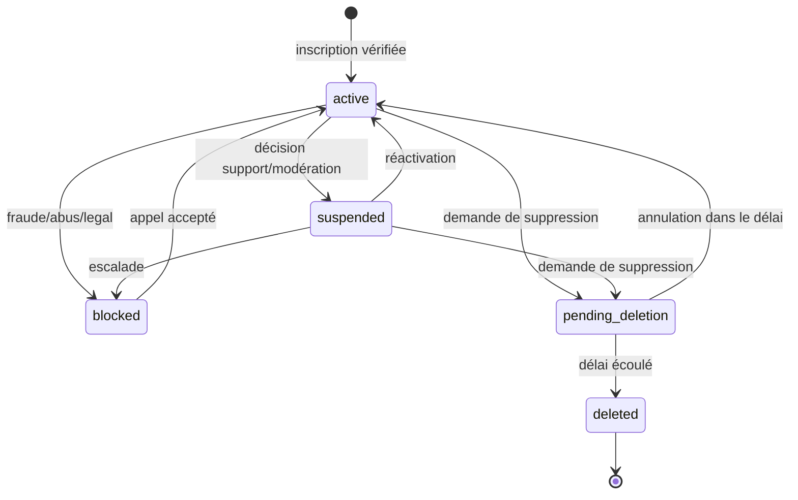

| Transition | Acteur | Guards | Effets |
|---|---|---|---|
| `→ active` | Système / support | Identité vérifiée | Session possible, préférences initialisées |
| `active → suspended` | Support, modération | Motif obligatoire | Nouvelle écoute/achat/téléchargement bloqués ; sessions de lecture révoquées ; données conservées |
| `suspended → active` | Support | Motif de réactivation | Accès rétabli ; entitlement conservé |
| `active/suspended → blocked` | Modération, admin | Preuve/abus/obligation légale | Sessions et leases révoqués ; connexion refusée |
| `blocked → active` | Admin | Appel accepté, double validation | Accès rétabli, audit |
| `active/suspended → pending_deletion` | Auditeur | Abonnement résolu ou annulation confirmée | Lecture seule ; nouvelles données interdites ; notification |
| `pending_deletion → active` | Auditeur | Dans le délai de grâce | Annulation de la suppression |
| `pending_deletion → deleted` | Worker | Délai écoulé, obligations financières résolues | Anonymisation, imports supprimés, sessions révoquées |

**Interdits :** `deleted → *`, `blocked → pending_deletion` sans résolution
légale, suppression avec abonnement actif non résolu, suppression avec factures
non conservées.

---

## 3. Œuvre et édition

### 3.1 Œuvre

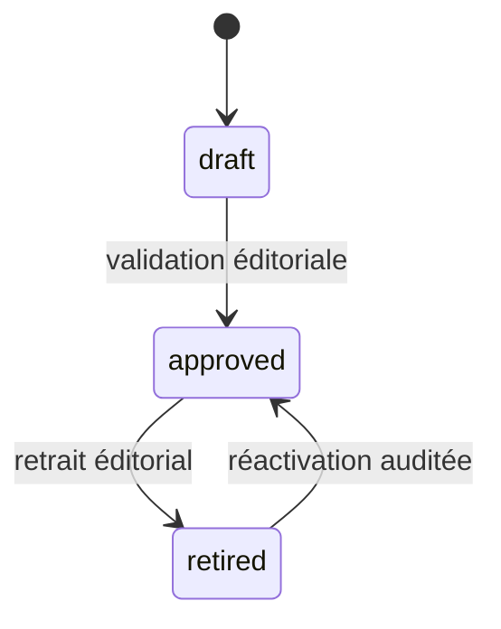

| Transition | Guards | Effets |
|---|---|---|
| `draft → approved` | Titre, langue, au moins un auteur, catégorie | L'œuvre peut recevoir des éditions publiables |
| `approved → retired` | Motif | Découverte masquée ; éditions retirées ; historique conservé |
| `retired → approved` | Motif, audit | Réapparition possible si les éditions sont disponibles |

### 3.2 Édition

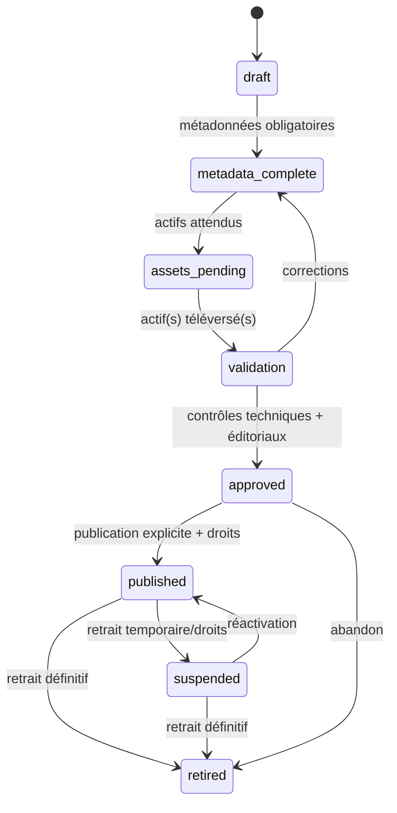

| Transition | Guards | Effets |
|---|---|---|
| `draft → metadata_complete` | Champs obligatoires présents | Version de métadonnées |
| `metadata_complete → assets_pending` | Structure de pistes/chapitres définie | Actifs attendus |
| `assets_pending → validation` | Au moins un actif uploadé | Validation technique |
| `validation → metadata_complete` | Corrections demandées | Blockers listés |
| `validation → approved` | Tous les checks pass, durée cohérente, couverture | Édition prête |
| `approved → published` | **Droits actifs**, actif `ready`, couverture, date | Visible, achetable/écoutable ; événement `edition.published` |
| `published → suspended` | Motif (droits, qualité, légal) | Plus de nouvelle diffusion ; accès existants selon politique ; notification |
| `suspended → published` | Droits rétablis, correctifs validés | Reprise ; audit |
| `published/suspended → retired` | Motif, double validation si droits | Découverte masquée ; historique/bibliothèque préservés ; pas de suppression |

**Interdits :** `draft → published`, `assets_pending → published`,
`validation → published` sans droits, `retired → published` sans nouvelle
validation, publication sans actif `ready`.

---

## 4. Actif audio

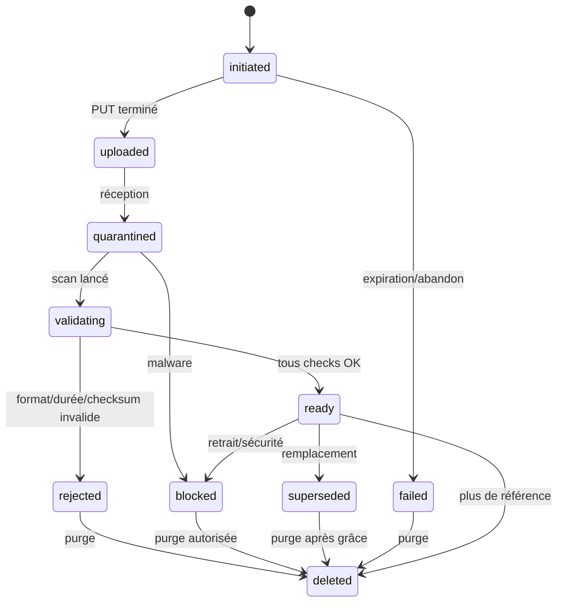

| Transition | Guards | Effets |
|---|---|---|
| `initiated → uploaded` | Taille/checksum reçus | Objet AURA vérifié |
| `uploaded → quarantined` | Type autorisé | Isolation, pas de lecture |
| `quarantined → validating` | Scan lancé | Checks techniques |
| `validating → ready` | MIME/magic, durée, codec, checksum, AV, loudness | Piste lisible |
| `validating → rejected` | Au moins un check bloquant | Motif, pas de publication |
| `quarantined → blocked` | Malware | Notification sécurité, audit |
| `ready → superseded` | Nouvel actif `ready` | Bascule atomique, ancien conservé |
| `ready → blocked` | Retrait/sécurité | Plus de diffusion |
| `* → deleted` | Aucune référence active, grâce, pas de legal hold | Purge AURA séparée, audit |

**Interdits :** `validating → ready` avec un check obligatoire en échec,
`initiated → ready`, `rejected → ready` sans nouveau cycle de validation,
`deleted → *`.

---

## 5. Fenêtre de droits

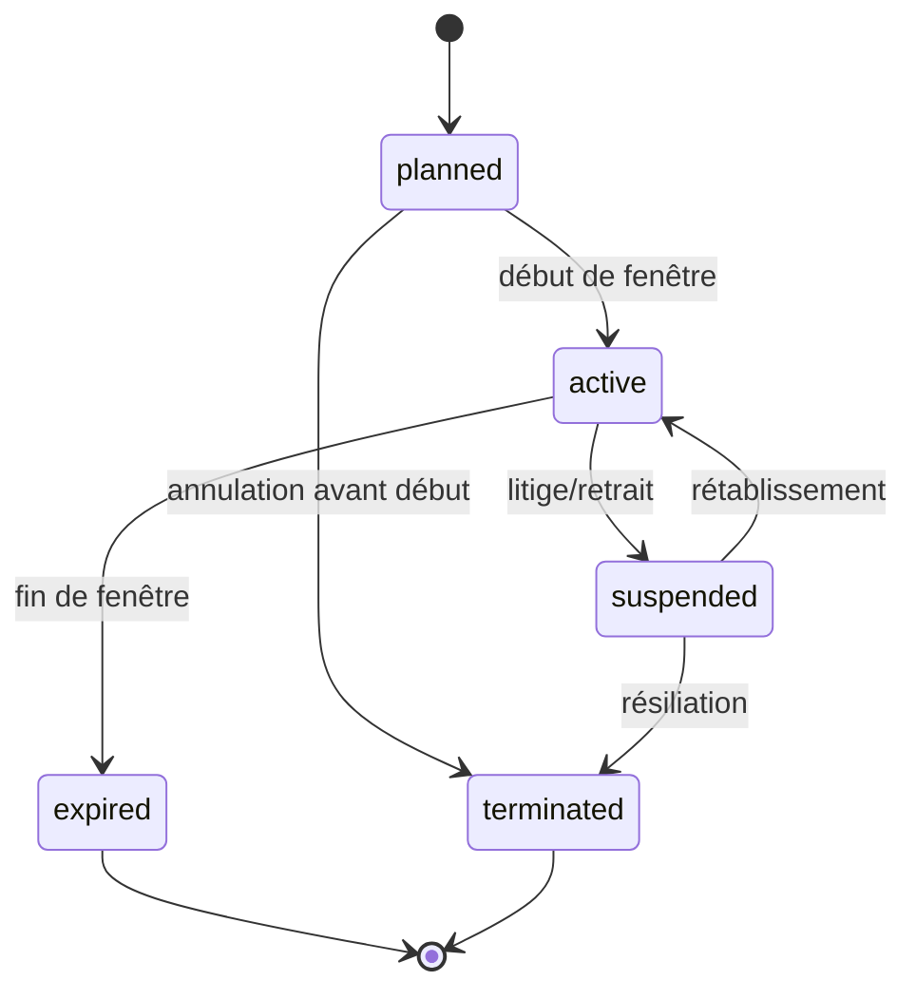

| Transition | Guards | Effets |
|---|---|---|
| `planned → active` | Date de début atteinte, contrat valide | Publication/diffusion autorisée |
| `active → suspended` | Motif légal/contractuel | Nouveaux accès bloqués ; URLs courtes expirent |
| `suspended → active` | Litige résolu | Reprise |
| `active → expired` | Date de fin atteinte | Plus de nouveaux accès ; historique conservé |
| `planned/active/suspended → terminated` | Résiliation | Retrait ; audit ; notification éventuelle |

**Interdits :** `expired → active` (nouvelle fenêtre requise),
`terminated → active`, diffusion sans fenêtre active.

---

## 6. Entitlement

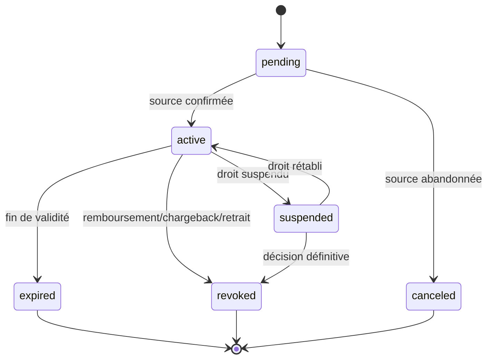

| Transition | Guards | Effets |
|---|---|---|
| `pending → active` | Paiement confirmé, promotion valide ou droit manuel | Accès calculable ; audit |
| `pending → canceled` | Commande annulée/expirée | Aucun accès |
| `active → suspended` | Litige, contrôle, droits | Accès refusé temporairement |
| `suspended → active` | Litige résolu | Accès rétabli |
| `active → expired` | `valid_until` atteint | Accès refusé ; nouvelle source possible |
| `active/suspended → revoked` | Remboursement, chargeback, fraude, retrait | Accès refusé ; écriture financière si applicable |

**Interdits :** `expired → active` (créer un nouvel entitlement),
`revoked → active`, `pending → active` sans source confirmée.

---

## 7. Abonnement

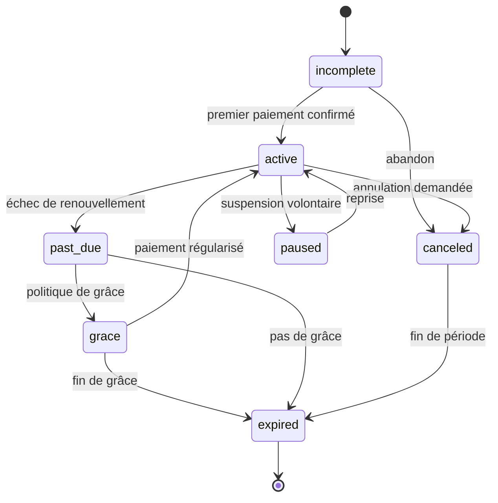

| Transition | Guards | Effets |
|---|---|---|
| `incomplete → active` | Paiement confirmé | Période courante, entitlement de plan |
| `active → past_due` | Échec de paiement | Notification, accès maintenu pendant la grâce |
| `past_due → grace` | Politique | Accès limité/maintenu, relances |
| `grace → active` | Paiement confirmé | Nouvelle période |
| `grace/past_due → expired` | Fin de grâce | Accès au plan coupé |
| `active → canceled` | Demande auditeur | `cancel_at_period_end` ; accès jusqu'à la fin |
| `canceled → expired` | Fin de période | Accès coupé |
| `active → paused` | Politique | Accès suspendu, période gelée |

**Interdits :** `incomplete → active` sans paiement, `expired → active`
(réabonnement = nouvel abonnement), double période active.

---

## 8. Commande et paiement

### 8.1 Commande

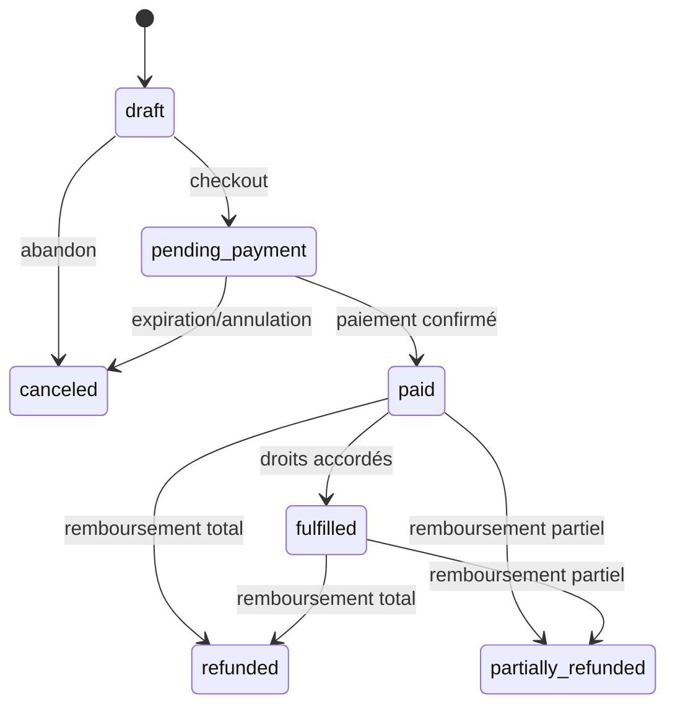

| Transition | Guards | Effets |
|---|---|---|
| `draft → pending_payment` | Lignes valides, prix courant | Réservation de prix, idempotency key |
| `pending_payment → paid` | Paiement `succeeded` | Entitlement(s), facture, outbox |
| `pending_payment → canceled` | Expiration (24 h) ou annulation | Aucun droit |
| `paid → fulfilled` | Entitlement actif | Bibliothèque mise à jour |
| `paid/fulfilled → refunded/partially_refunded` | Remboursement confirmé | Révocation selon politique, écriture |

**Interdits :** `paid → pending_payment`, modification des montants après
`paid`, `canceled → paid`.

### 8.2 Paiement

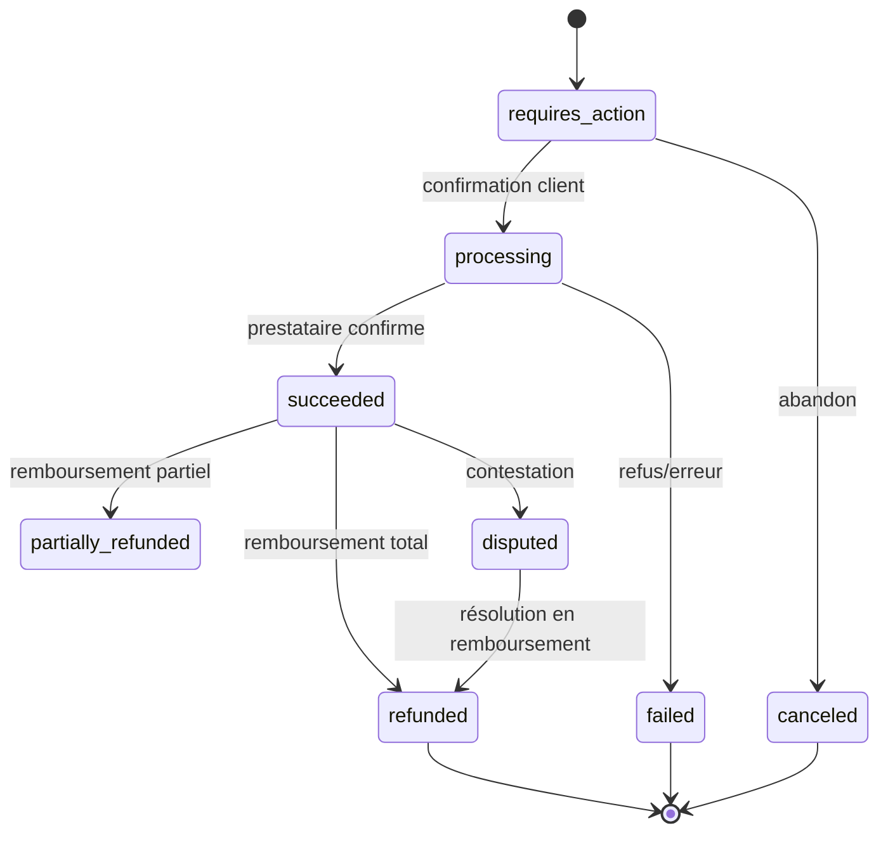

**Interdits :** `succeeded → failed`, `refunded → succeeded`,
`failed → succeeded` (nouveau paiement requis), appliquer deux fois le même
événement prestataire.

---

## 9. Session d'écoute

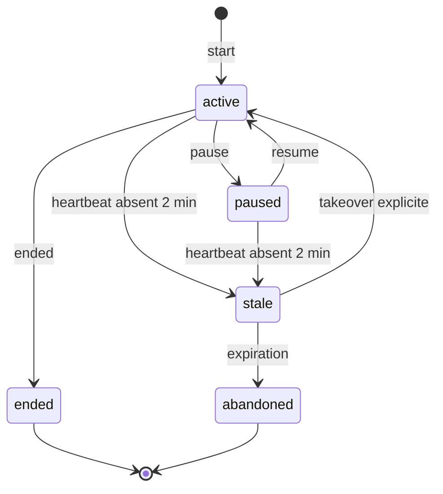

| Transition | Guards | Effets |
|---|---|---|
| `→ active` | Édition autorisée, appareil actif, lease disponible | Progression initiale, événement `start` |
| `active → paused` | — | `pause` enregistré |
| `paused → active` | Lease encore valide | `resume` |
| `active/paused → stale` | Aucun heartbeat depuis 2 min | Lease libérable |
| `stale → active` | Prise de relais explicite, aucune autre session active | Nouveau lease, événement `takeover` |
| `active → ended` | `ended` ou seuil de complétion | `completed_at` si applicable |
| `stale → abandoned` | Expiration | Historique conservé |

**Interdits :** une session `ended/abandoned` ne peut plus émettre d'événement
de progression ; une session non active ne peut pas écrire la progression sans
takeover.

---

## 10. Grant de téléchargement et lease hors ligne

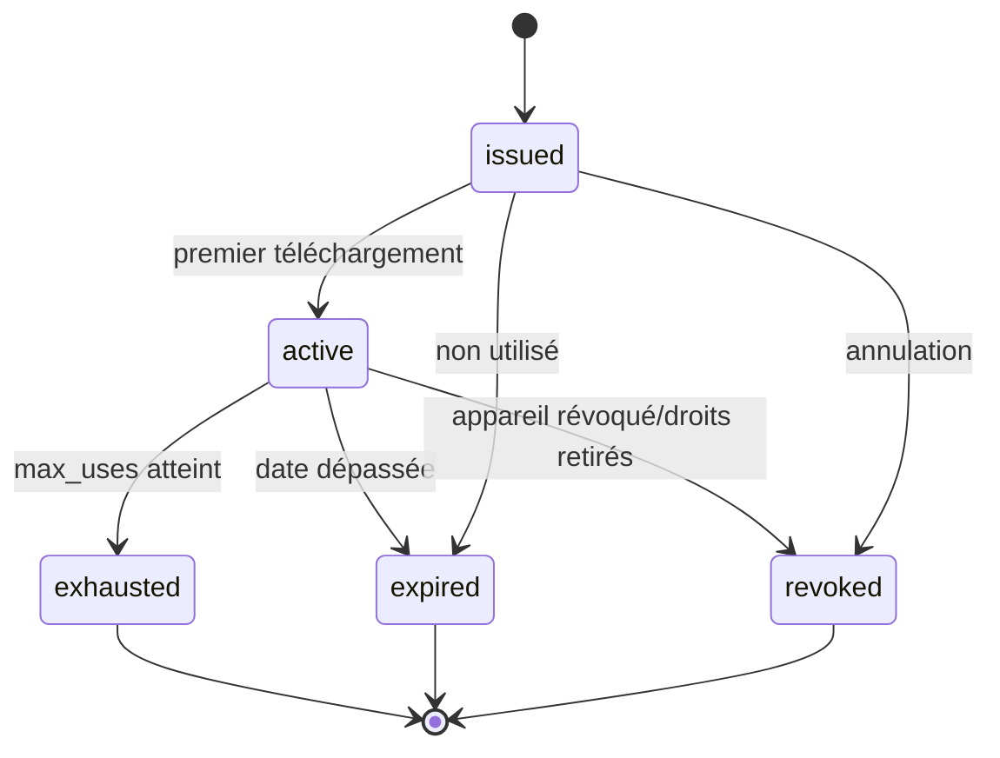

| Transition | Guards | Effets |
|---|---|---|
| `issued → active` | Appareil actif, décision d'accès valide | URL/manifeste, compteur |
| `active → exhausted` | `used_count = max_uses` | Plus de nouvel usage |
| `active → expired` | `expires_at` atteint | Plus de renouvellement |
| `issued/active → revoked` | Révocation appareil/droits | Lease invalidé au plus tard à expiration |
| `expired → *` | — | Nouveau grant requis |

**Lease :** `issued → active → expired/revoked` ; un lease ne survit jamais à
l'entitlement ou à la fenêtre de droits.

---

## 11. Appareil

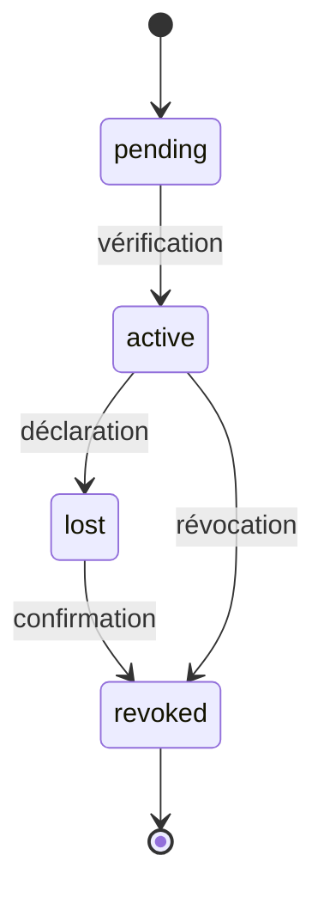

| Transition | Guards | Effets |
|---|---|---|
| `pending → active` | Limite d'appareils non atteinte | Sessions autorisées |
| `active → lost` | Déclaration auditeur | Notification, limite de sécurité |
| `lost → revoked` | Confirmation | Sessions et leases révoqués |
| `active → revoked` | Auditeur/support | Révocation immédiate |
| `revoked → *` | — | Réenregistrement = nouvel appareil |

---

## 12. Import personnel

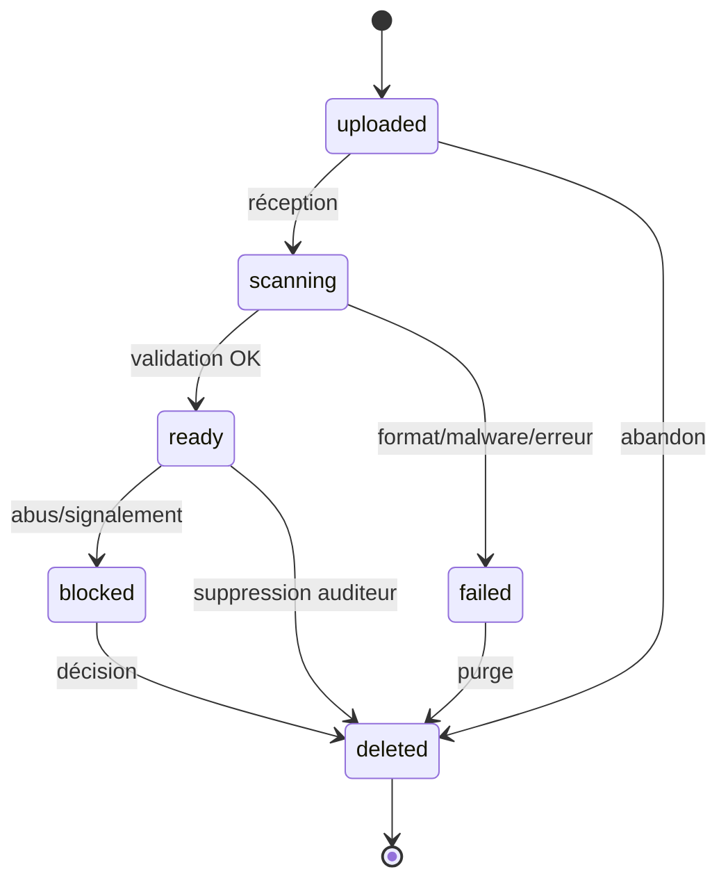

**Interdits :** `ready → published`, `ready → shared`, `scanning → ready` sans
scan, `deleted → *`.

---

## 13. Notification

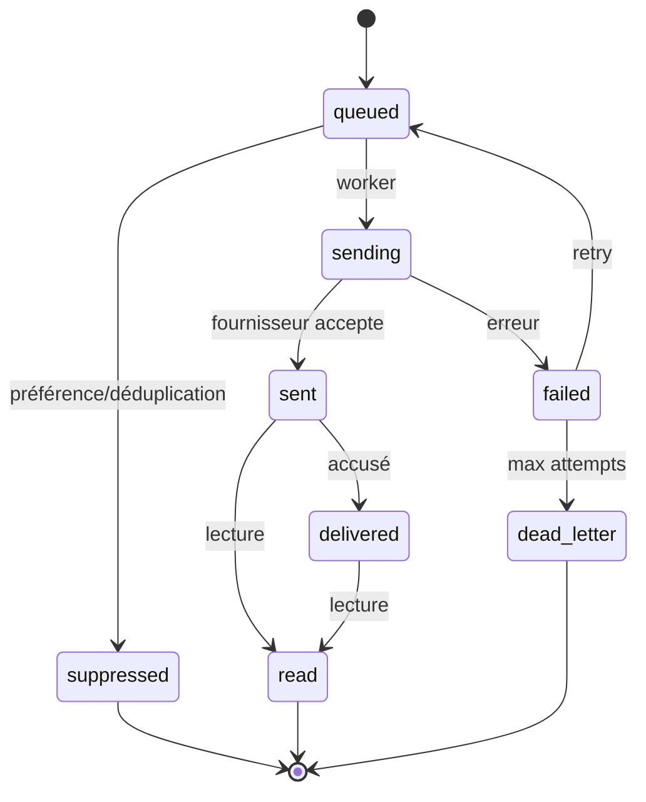

**Interdits :** `queued → sent` sans envoi réel, `suppressed → sending` sans
nouvelle préférence, notification avant confirmation métier.

---

## 14. Action administrative et modération

### 14.1 Action administrative

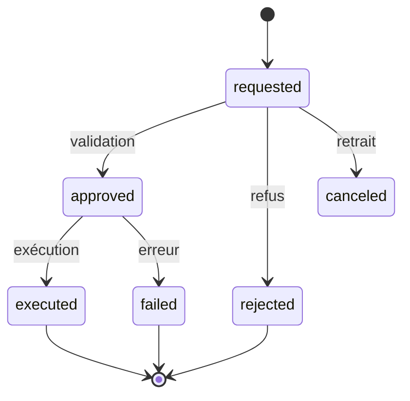

Une action sensible (`refund > seuil`, `retrait de droits`, `suppression de
compte`, `publication`) exige un `approved_by` différent du `requested_by`.

### 14.2 Cas de modération

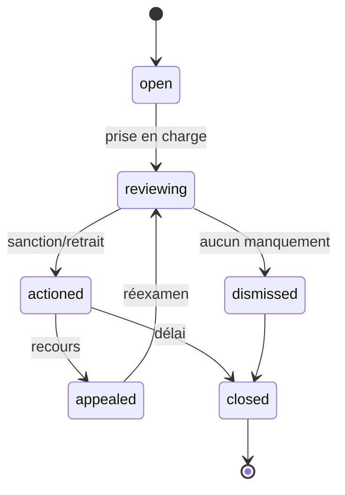

**Interdits :** `closed → actioned` sans réouverture auditée, décision sans
motif, sanction sans notification.

---

## 15. Matrice des transitions interdites (extrait)

| Ressource | Interdiction | Raison |
|---|---|---|
| Compte | `deleted → active` | Nouvelle inscription requise |
| Édition | `draft → published` | Validation et droits obligatoires |
| Édition | `retired → published` | Nouvelle validation requise |
| Actif | `rejected → ready` | Nouveau cycle de validation |
| Droits | `expired → active` | Nouvelle fenêtre contractuelle |
| Entitlement | `revoked → active` | Nouvelle source requise |
| Abonnement | `expired → active` | Réabonnement = nouvel agrégat |
| Paiement | `succeeded → failed` | Le prestataire fait foi |
| Écoute | `ended → active` | Nouvelle session requise |
| Appareil | `revoked → active` | Nouvel appareil requis |
| Import | `ready → published` | Jamais public |
| Audit | `* → modifié/supprimé` | Immuable |

---

## 16. Règles de transition communes

1. **Guard d'acteur** : la commande vérifie le rôle et le périmètre.
2. **Guard d'état** : la transition n'est valide que depuis les états listés.
3. **Guard d'invariant** : les invariants du domaine sont revérifiés dans la
   transaction.
4. **Effets** : mise à jour de l'agrégat + outbox, dans la même transaction.
5. **Audit** : toute transition sensible écrit un `AuditEvent` avant le commit
   (ou dans la même transaction).
6. **Idempotence** : une commande rejouée avec la même clé ne produit pas de
   second effet.
7. **Compensation** : si un effet externe échoue après le commit, une saga
   compense explicitement ; jamais de « correction silencieuse ».
