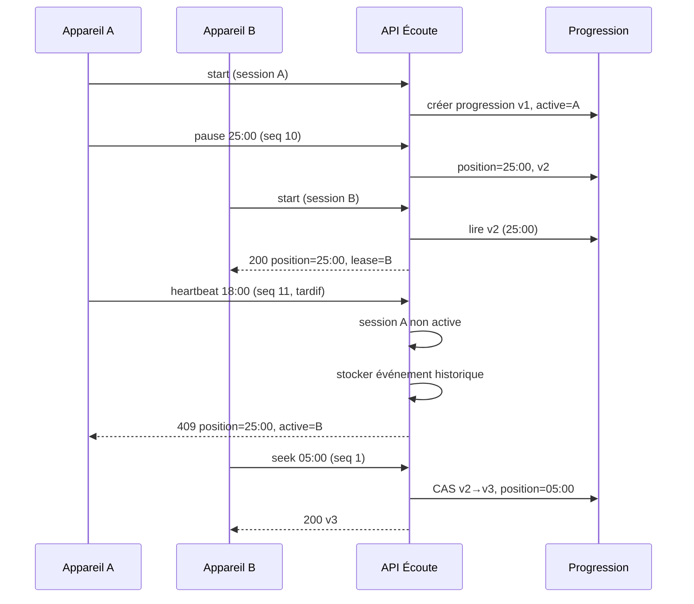
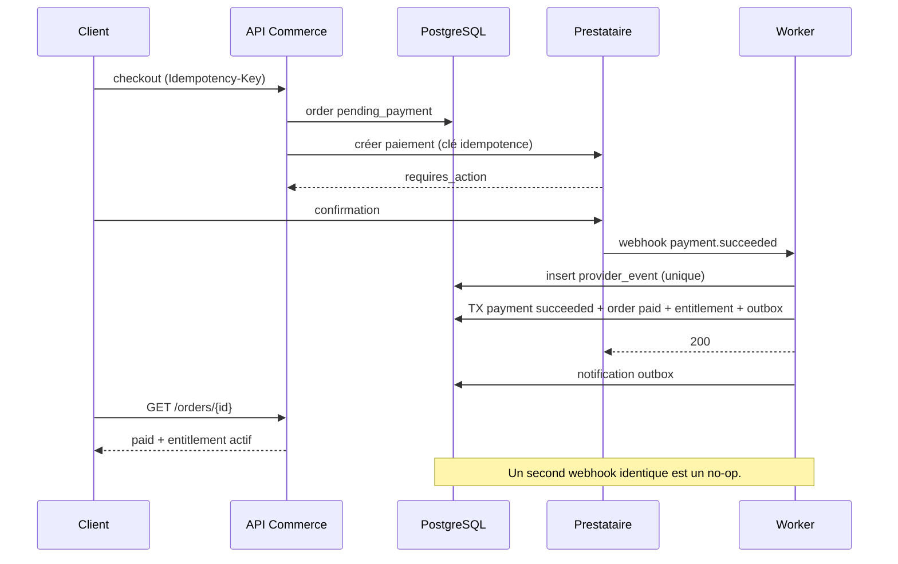

# 06 — Scénarios de défaillance et procédures de récupération

**Objectif :** définir le comportement attendu lorsque les choses ne se passent
pas comme prévu : doublons, retards, concurrence, pannes, suppressions et
événements dans le désordre.

---

## 1. Taxonomie des défaillances

| Famille | Exemples | Question de conception |
|---|---|---|
| **Doublon** | double clic, webhook rejoué, requête réessayée | L'opération est-elle idempotente ? |
| **Désordre** | événement ancien reçu après un récent | Comment ordonner sans écraser ? |
| **Partiel** | upload interrompu, job interrompu, réponse perdue | Comment détecter et reprendre ? |
| **Concurrence** | deux appareils, deux remboursements, deux workers | Quel verrou/version tranche ? |
| **Indisponibilité** | AURA, prestataire, base, e-mail | Quel fallback et quel message ? |
| **Cohérence différée** | cache, projection, index de recherche | Quelle fraîcheur est acceptable ? |
| **Malveillance** | rejeu, falsification, IDOR, webhook forgé | Quelle vérification empêche l'abus ? |
| **Suppression** | compte, collection, appareil, contenu | Que conserve-t-on et que détruit-on ? |

---

## 2. Catalogue des scénarios

| ID | Scénario | Détection | Comportement attendu | Récupération | Invariant |
|---|---|---|---|---|---|
| FAIL-01 | Double clic sur « acheter » | Même `idempotency_key` | Une seule commande, un seul paiement, un seul entitlement | Retour de la commande existante | INV-05 |
| FAIL-02 | Webhook de paiement reçu deux fois | `(provider, event_id)` unique | Deuxième réception = no-op, réponse 2xx | Rejeu sûr | INV-05 |
| FAIL-03 | Webhook `failed` reçu après `succeeded` | État actuel plus avancé | Événement marqué `ignored_stale`, pas de régression | Réconciliation | INV-05 |
| FAIL-04 | Paiement confirmé mais réponse perdue | Commande encore `pending_payment` | Le webhook confirme ; le client peut interroger la commande | Réconciliation prestataire | INV-05 |
| FAIL-05 | Paiement en attente plusieurs heures | `pending_payment` ancien | Aucun accès ; expiration après 24 h ; relance | Webhook ou annulation | BR-BIL-04 |
| FAIL-06 | Annulation juste avant renouvellement | `cancel_at_period_end` | Accès jusqu'à la fin de période, pas de nouveau prélèvement | Confirmation prestataire | BR-BIL-07 |
| FAIL-07 | Remboursement après utilisation | Remboursement confirmé | Entitlement révoqué selon politique ; accès futur coupé ; historique conservé | Écriture de grand livre | BR-BIL-06 |
| FAIL-08 | Abonnement expiré pendant une écoute | Décision d'accès expirée | L'URL courte expire ; pas de nouveau segment ; message explicite | Renouvellement | BR-ACC-05 |
| FAIL-09 | Deux achats du même livre | Même auditeur + même édition | Si déjà entitlement actif : retour de l'existant ou refus explicite ; jamais double débit silencieux | Remboursement si double | BR-ACC-03 |
| FAIL-10 | Deux appareils modifient la progression | Sessions concurrentes | Une session active ; l'autre reçoit 409 + état autoritatif | Reprise explicite | INV-06 |
| FAIL-11 | Progression hors ligne synchronisée en conflit | Lot offline en retard | Événements historisés ; pas d'écrasement ; conflit signalé | Choix utilisateur | BR-PLY-12 |
| FAIL-12 | Vieille position envoyée par un ordinateur | Session non active | Événement conservé, progression inchangée | 409 avec position courante | INV-06 |
| FAIL-13 | Livre retiré pendant l'écoute | `edition.suspended` | Plus de nouvelle URL ; URL en cours expire ; bibliothèque affiche « indisponible » | Réactivation ou remboursement | BR-ACC-07 |
| FAIL-14 | Compte suspendu pendant l'écoute | Statut auditeur | Sessions de lecture révoquées, nouvelles décisions refusées ; données conservées | Réactivation support | BR-USR-03 |
| FAIL-15 | Suppression demandée avec abonnement actif | Statut `pending_deletion` | Suppression différée ; abonnement résolu ; factures conservées | Annulation ou attente fin de période | BR-USR-06 |
| FAIL-16 | Fichier corrompu | Checksum/ffprobe | Actif `rejected`, jamais publié | Nouvel upload | INV-03 |
| FAIL-17 | Réseau interrompu pendant l'import | Upload incomplet | Actif non `ready`, intention expirée, reprise possible | Reprise ou abandon | BR-AST-06 |
| FAIL-18 | Import personnel en double | Même checksum | Signalement, choix conserver/remplacer/annuler | Décision utilisateur | BR-LIB-11 |
| FAIL-19 | Collection supprimée | Suppression logique | Aucun livre supprimé ; items détachés | Recréation possible | INV-08 |
| FAIL-20 | Action administrative répétée | Même clé d'action | No-op idempotent, audit unique | Rejeu | INV-10 |
| FAIL-21 | Restauration après incident | Sauvegarde/restauration | Données cohérentes, projections reconstruites, événements rejoués | Runbook backup | INV-22 |
| FAIL-22 | Événements reçus dans le désordre | `client_seq`/`occurred_at` | Ordre par session, stale non appliqué | Projection rebuild | BR-PLY-05 |
| FAIL-23 | Deux heartbeats concurrents | Version de progression | CAS : une version gagne, l'autre 409 | Retry avec état | INV-13 |
| FAIL-24 | Appareil révoqué hors ligne | Révocation serveur | Lease non renouvelé ; expiration locale | Réenregistrement | BR-OFF-08 |
| FAIL-25 | Fenêtre de droits à la frontière d'un fuseau | Date UTC | Évaluation en UTC ; pas d'ambiguïté | Audit de la fenêtre | BR-ACC-08 |
| FAIL-26 | Cache d'autorisation périmé | TTL 60 s max | Expiration courte + invalidation sur événement | Rafraîchissement | BR-ACC-11 |
| FAIL-27 | Prestataire de paiement indisponible | Timeout/5xx | Paiement `processing`, pas d'accès ; retry borné | Réconciliation | BR-BIL-11 |
| FAIL-28 | Notification en double ou retardée | `dedupe_key` | Une seule notification ; contenu basé sur l'état confirmé | Rejeu | BR-NOT-03 |
| FAIL-29 | Index de recherche en retard | Décalage de projection | Le catalogue reste la source ; badge « en cours d'indexation » | Rebuild | BR-DSC-02 |
| FAIL-30 | Deadlock base | Erreur SQL | Retry transactionnel borné ; pas de double effet | Retry | INV-05 |
| FAIL-31 | AURA S3 indisponible | 5xx/timeout | Pas d'URL émise ; erreur `STORAGE_DEGRADED` ; retry | Rétablissement | INV-03 |
| FAIL-32 | Webhook forgé | Signature invalide | 401/400, aucun effet, alerte | Rotation secret | BR-BIL-11 |
| FAIL-33 | Chargeback | Prestataire | Accès révoqué, écriture, notification, enquête | Appel | BR-BIL-12 |
| FAIL-34 | Changement d'offre avec prorata | Événement d'abonnement | Une seule période active, montant calculé explicitement | Réconciliation | BR-BIL-09 |
| FAIL-35 | Import personnel infecté | Antivirus | Actif bloqué, notification, suppression sécurisée | Analyse | BR-AST-05 |
| FAIL-36 | Retrait pendant un téléchargement | `revoked`/`expired` | Téléchargement en cours peut échouer ; pas de nouveau grant | Nouvelle autorisation impossible | INV-12 |
| FAIL-37 | Entrée de bibliothèque supprimée pendant l'écoute | `removed_at` | L'écoute continue si entitlement ; la bibliothèque ne l'affiche plus | Réajout | BR-LIB-04 |
| FAIL-38 | Événement d'écoute dupliqué | `event_id` unique | No-op | Retry client | INV-14 |
| FAIL-39 | Worker interrompu en plein job | Lease expirée | Job repris par un autre worker ; idempotence | Retry | BR-BIL-11 |
| FAIL-40 | Restauration base avec paiements manquants | Réconciliation | Les événements prestataire sont rejoués depuis la source | Backfill | INV-05 |

---

## 3. Étude approfondie — conflit de progression

### 3.1 Scénario nominal

1. 10:00 — Auditeur ouvre le livre sur l'ordinateur A. Le serveur crée
   `session_A`, active, `last_client_seq=0`.
2. 10:05 — Il quitte A à 25:00. A envoie `pause` à 25:00.
3. 10:06 — Il reprend sur le téléphone B. B crée `session_B` ; A n'a plus de
   heartbeat depuis 1 min. B demande le lease ; le serveur vérifie que A n'est
   pas actif récemment (seuil 120 s). B devient active et reçoit la position
   autoritative 25:00.
4. 10:07 — A, resté en arrière-plan, envoie tardivement `heartbeat` à 18:00.
   Le serveur voit que `session_A` n'est plus active. Il **enregistre**
   l'événement comme historique, mais ne touche pas `listening_progress`.
   Il répond `409` avec `{position_ms: 1500000, session_id: B}`.
5. Le client A affiche « Vous écoutez sur un autre appareil. Reprendre ici ? »
   et ne sauvegarde plus silencieusement.

### 3.2 Variante : retour en arrière volontaire

1. Sur B, l'auditeur déplace la barre à 05:00. C'est un `seek` de la session
   active. Le serveur accepte, met la progression à 05:00 (même si c'est plus
   bas) et incrémente la version.
2. Aucune règle « garder le maximum » n'est appliquée. Le maximum n'est pas la
   vérité.

### 3.3 Variante : deux sessions actives par erreur

Le serveur garantit **un seul lease actif** par `(listener, edition)`. La
création d'une seconde session est autorisée, mais elle reste `paused` ou
`waiting` jusqu'à takeover. Un takeover explicite est un événement
`takeover` avec `expected_version` ; si la version a changé, le serveur répond
409 et le client repropose l'état courant.

### 3.4 Diagramme

### 3.5 Règles de résolution

| Situation | Décision |
|---|---|
| Même session, `client_seq` supérieur | Appliquer si position valide |
| Même session, `client_seq` inférieur/égal | Stocker comme doublon/retard, ne pas appliquer |
| Session non active, événement récent | Stocker, répondre 409 avec état autoritatif |
| Session non active, takeover explicite | Appliquer si `expected_version` correspond |
| Aucune session active depuis > 120 s | La nouvelle session peut prendre le lease |
| Événement offline du même appareil | Trier par `client_seq`, appliquer le dernier valide |
| Événement offline d'un autre appareil | Stocker, conflit, choix utilisateur |
| Position invalide | Rejeter 422, ne pas modifier la progression |
| `ended` sans position cohérente | Complétion seulement si durée connue et seuil atteint |

---

## 4. Étude approfondie — paiement dupliqué, perdu ou désordonné

### 4.1 Double clic

- Le client envoie `POST /checkout` avec `Idempotency-Key`.
- Le serveur crée ou retourne la même commande.
- Un second clic avec la même clé ne crée pas de seconde commande.
- Le prestataire reçoit une clé d'idempotence équivalente.

### 4.2 Webhook rejoué

1. Vérifier la signature.
2. Insérer `(provider, event_id)` dans `provider_event` ; si conflit, répondre
   2xx et s'arrêter.
3. Charger l'agrégat `Payment`/`Order`.
4. Si la transition est déjà appliquée (même état), no-op.
5. Si l'événement est plus ancien que l'état courant, marquer
   `ignored_stale`.
6. Sinon, appliquer la transition + outbox + audit dans la même transaction.

### 4.3 Réponse perdue

Le webhook est la source de vérité. Le client interroge
`GET /orders/{id}` ; la commande reste `pending_payment` jusqu'à confirmation.
Un job de réconciliation interroge le prestataire pour les commandes bloquées
depuis plus de 15 minutes.

### 4.4 Paiement en attente

- Aucun entitlement.
- La commande expire après 24 h.
- Le prestataire peut encore confirmer ; dans ce cas, la commande est
  réouverte si le paiement est valide, sinon remboursée.
- Notification « paiement en attente » au plus une fois par 24 h.

### 4.5 Remboursement après utilisation

- Le remboursement est une nouvelle écriture de grand livre.
- L'entitlement direct est révoqué ; l'accès futur est refusé.
- L'historique d'écoute et la facture restent.
- Si l'auditeur a une autre source (abonnement actif), l'accès peut continuer ;
  la décision d'accès liste les sources.
- La politique « remboursement après consommation » est une décision produit et
  légale, pas une règle technique implicite.

### 4.6 Diagramme

---

## 5. Étude approfondie — expiration d'abonnement pendant l'écoute

| Moment | Comportement |
|---|---|
| Décision d'accès | Valide au maximum 60 s ; porte `expires_at` |
| URL de lecture | TTL court (recommandé 5 min), signée pour une piste/segment |
| Segment suivant | Nouvelle décision ; si abonnement expiré, refus |
| Piste en cours | Peut finir dans la fenêtre de l'URL, pas au-delà |
| Téléchargement hors ligne | Lease existant jusqu'à expiration ; renouvellement refusé |
| Message | « Votre abonnement a expiré. Renouvelez pour continuer. » |
| Bibliothèque | Reste visible ; badge « abonnement requis » |
| Historique | Conservé ; progression conservée |

**Décision à valider :** autoriser ou non la fin du chapitre en cours. Le design
par défaut est **non** : l'accès s'arrête à l'expiration de l'URL courte. Une
grâce de chapitre serait un paramètre produit explicite.

---

## 6. Procédures de récupération

### 6.1 Rejeu d'outbox

1. Identifier les événements `pending`/`failed` depuis plus de N minutes.
2. Vérifier l'idempotence du consommateur.
3. Rejouer par lots, avec backoff.
4. Alerter si la file morte dépasse un seuil.
5. Ne jamais modifier l'événement source ; créer un nouvel événement si le
   payload doit changer.

### 6.2 Réconciliation des paiements

1. Lister les commandes `pending_payment` de plus de 15 minutes.
2. Interroger le prestataire par `provider_payment_id`.
3. Appliquer l'état réel via la même machine à états.
4. Comparer le grand livre aux totaux prestataire ; écart = alerte.
5. Documenter chaque écart et sa résolution.

### 6.3 Reconstruction des projections

1. Rejouer les événements depuis la dernière projection valide.
2. Comparer les compteurs (nb événements, somme des durées, complétions).
3. Basculer la projection seulement après validation.
4. Conserver l'ancienne projection pour rollback.

### 6.4 Restauration après incident

1. Restaurer PostgreSQL depuis la dernière sauvegarde vérifiée.
2. Rejouer les événements prestataire disponibles depuis la source.
3. Reconciliar les objets AURA par checksum.
4. Reconstruire les projections.
5. Vérifier les invariants critiques (paiements, entitlements, progression).
6. Consigner l'incident et les écarts dans un rapport.

### 6.5 Indisponibilité AURA

- Aucune URL de lecture n'est émise.
- Les clients reçoivent `503 STORAGE_DEGRADED` avec `Retry-After`.
- Les écritures de progression restent possibles (elles ne dépendent pas des
  octets) mais la lecture est bloquée.
- Les téléchargements en cours peuvent échouer ; le grant reste valide jusqu'à
  expiration.
- Retry borné et alerte ; pas de fallback vers un bucket non autorisé.

---

## 7. Règles de conception pour les défaillances

1. **Toute opération critique est idempotente** ou possède une clé
   d'idempotence.
2. **Aucun état métier n'est déduit d'un timeout** ; un timeout est une
   incertitude, pas un échec définitif.
3. **Un événement ancien est conservé, pas appliqué.**
4. **Une réponse perdue ne doit pas être interprétée comme un échec.**
5. **Un job interrompu doit être reprenable** via lease et idempotence.
6. **Une panne externe ne doit pas corrompre l'état local** ; elle produit un
   état `pending`/`degraded` explicite.
7. **Les corrections manuelles sont des commandes auditables**, pas des
   `UPDATE` SQL.
8. **Chaque scénario critique a un test automatisé** (voir 07).
