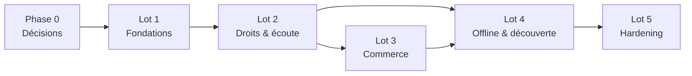

# 08 — Plan de réalisation, migration et registre des risques

**Objectif :** découper la construction en lots vérifiables, éviter le big bang
et rendre explicites les risques qui peuvent invalider le projet.

---

## 1. Principes de livraison

1. **Tranche verticale.** Chaque lot livre un parcours complet, pas une couche
   technique isolée.
2. **Gate de conception.** Aucun code avant validation des décisions de
   [`09-design-review-and-decisions.md`](09-design-review-and-decisions.md).
3. **Pas de douze domaines en parallèle.** Les dépendances imposent l'ordre.
4. **Feature flags.** Chaque lot peut être désactivé sans migration destructive.
5. **Migrations additives.** Aucune suppression de colonne ou de table sans
   procédure de rétention.
6. **Observabilité dès le premier lot.** Un domaine sans métriques n'est pas
   livré.
7. **Tests de défaillance avant activation.** Un lot critique ne passe pas en
   production sans ses tests de concurrence et de reprise.
8. **Migration par export/import.** Pas de double écriture entre l'ancien
   portail et le nouveau backend.

---

## 2. Phase 0 — Cadrage et décisions

**Durée indicative :** 1 à 2 semaines.
**Objectif :** transformer ce dossier en décisions signées.

| Livrable | Contenu |
|---|---|
| ADR-001 | Frontière AURA / Audiobook et mode de déploiement |
| ADR-002 | Modèle commercial du MVP |
| ADR-003 | Identité et fournisseur d'authentification |
| ADR-004 | Prestataire de paiement, devises, fiscalité |
| ADR-005 | Politique de contenus personnels |
| ADR-006 | Politique hors ligne et DRM |
| ADR-007 | Territoires et restrictions de droits |
| ADR-008 | Reprise du portail existant et sort de `/m/{slug}` |
| ADR-009 | Base de données et outil de migration |
| ADR-010 | Rétention, suppression et obligations légales |
| Threat model | Actifs, menaces, surfaces, mitigations |
| Inventaire de migration | Utilisateurs, packs, objets, chapitres, progressions |

**Critère de sortie :** toutes les décisions D-01 à D-10 sont tranchées, le
périmètre du MVP est écrit, le threat model est revu.

---

## 3. Les lots

### Lot 1 — Fondations métier (P0)

**Périmètre :**
- identité auditeur (Google OIDC), comptes, sessions, appareils, préférences ;
- catalogue : œuvre, édition, enregistrement, contributeurs, chapitres,
  catégories, collections éditoriales ;
- actifs : upload via AURA, validation technique, états, remplacement ;
- bibliothèque : entrées, favoris, collections privées ;
- moteur d'accès initial : politique `FreePolicy` + `ManualGrant` (pas de
  paiement) ;
- écoute : sessions, événements, progression, reprise, complétion ;
- administration minimale : création/édition, validation, publication,
  suspension ;
- audit et observabilité de base.

**Non-goals :** abonnements, paiements, téléchargements hors ligne,
recommandations, notifications riches.

**Critère de sortie :**
- publier une édition gratuite avec 3 pistes ;
- écouter sur 2 appareils, conflit de progression résolu ;
- aucune lecture sans décision d'accès ;
- tests des invariants INV-01, INV-02, INV-03, INV-06, INV-13 à INV-16,
  INV-20, INV-21 ;
- documentation admin et runbook de base.

**Taille relative :** M/L.

### Lot 2 — Cœur de l'expérience et droits (P0)

**Périmètre :**
- fenêtres de droits, contrats, territoires ;
- entitlements : achat manuel, promotion, plan (sans facturation réelle) ;
- résolveur d'accès complet (compte, entitlement, droits, actif, appareil) ;
- synchronisation multi-appareils et reprise ;
- complétion, historique, statistiques personnelles de base ;
- décisions d'accès auditables et cache court ;
- premiers tests de charge et de concurrence.

**Non-goals :** paiement réel, facture, remboursement, offline.

**Critère de sortie :**
- un livre sans droit est inaccessible même s'il est dans la bibliothèque ;
- un droit expiré/remboursé coupe l'accès ;
- un livre retiré pour droits n'est plus diffusé ;
- tests INV-04, INV-06, INV-11, INV-13, INV-16, INV-19 ;
- tableau de bord des refus d'accès.

**Taille relative :** L.

### Lot 3 — Commercialisation (P1)

**Périmètre :**
- produits, prix versionnés, offres, plans ;
- commandes, checkout, paiements, factures ;
- webhooks idempotents, boîte de réception, réconciliation ;
- abonnements, périodes, renouvellement, grâce, expiration ;
- achats, entitlements, remboursements, chargebacks ;
- grand livre append-only ;
- notifications transactionnelles ;
- séparation des rôles finance.

**Non-goals :** marketplace multi-vendeurs, facturation physique, TVA
internationale complexe si le prestataire ne la gère pas.

**Critère de sortie :**
- double clic = un seul débit ;
- webhook dupliqué = un seul effet ;
- paiement pending = aucun accès ;
- annulation/renouvellement/remboursement conformes ;
- réconciliation quotidienne sans écart non expliqué ;
- tests INV-05, INV-09, INV-18, FAIL-01 à FAIL-09, FAIL-27, FAIL-33.

**Taille relative :** XL (lot le plus critique).

### Lot 4 — Expérience avancée (P1)

**Périmètre :**
- téléchargements : grants, leases, appareils, checksums, reprise ;
- synchronisation hors ligne et conflits ;
- découverte : recherche, filtres, classement, recommandations simples ;
- notifications : préférences, déduplication, retries, historique ;
- analytique : faits d'écoute, agrégats, tableaux de bord ;
- modération de base.

**Critère de sortie :**
- téléchargement impossible sans droit ;
- lease tronqué à l'expiration du droit ;
- appareil révoqué ne renouvelle plus ;
- recherche exclut les imports personnels ;
- notifications dédupliquées ;
- projections reconstructibles ;
- tests INV-07, INV-12, INV-17, INV-19, INV-22.

**Taille relative :** L.

### Lot 5 — Exploitation avancée (P2)

**Périmètre :**
- administration avancée : double validation, break-glass, exports ;
- modération avancée et recours ;
- optimisation des performances et du cache ;
- résilience : chaos tests, restauration, plan de reprise ;
- DRM si la décision le requiert ;
- analytique commerciale approfondie ;
- automatisation des réconciliations et alertes.

**Critère de sortie :**
- scénarios de panne testés en staging ;
- restauration complète chronométrée ;
- runbooks à jour ;
- revue de sécurité externe ;
- SLO et alertes en production.

**Taille relative :** M.

---

## 4. Dépendances entre lots

**Règles :**
- Le Lot 2 ne dépend pas du paiement : il utilise `ManualGrant`/`FreePolicy`.
- Le Lot 3 branche les vrais fournisseurs d'entitlement sur le résolveur du
  Lot 2 ; il ne réimplémente pas la logique d'accès.
- Le Lot 4 ne peut pas précéder le Lot 2 (pas de lease sans droit).
- Le Lot 5 n'est pas un « polish » : c'est la condition d'exploitation.

---

## 5. Migration depuis le portail actuel

### 5.1 Inventaire

| Donnée | Volume estimé | Qualité | Traitement |
|---|---|---|---|
| `users` rôle `public` | À mesurer | OAuth stable | Mapping `oauth_sub` → `listener_identity` |
| `collections` | À mesurer | Pack ≠ œuvre | Nettoyage manuel, mapping pack → édition ou collection |
| `objects` audio | À mesurer | Checksum AURA fiable | Mapping → `asset`, puis `track` |
| `audio_chapters` | À mesurer | ffprobe | Mapping → `chapter`, vérification des bornes |
| `listen_progress` | À mesurer | LWW, non fiable | Import + événement `legacy`, conflits signalés |
| `published_at` / slugs | À mesurer | Public | Preview uniquement ; aucun droit payant |
| Sessions | — | Opérateur/public mêlés | Invalidation, reconnexion |

### 5.2 Étapes

1. **Geler** les nouvelles fonctionnalités du portail (correctifs de sécurité
   uniquement).
2. **Exporter** un snapshot anonymisé pour les tests de migration.
3. **Nettoyer** le catalogue : un pack = un livre ? une série ? plusieurs
   éditions ? décision éditoriale.
4. **Migrer** les identités et les progressions vers le nouveau schéma.
5. **Vérifier** : nombre d'auditeurs, nombre d'œuvres, checksums, positions.
6. **Paralléliser** en lecture seule : l'ancien portail reste consultable, le
   nouveau est en staging.
7. **Basculer** par feature flag, contenu par contenu.
8. **Désactiver** `/m/{slug}` pour tout contenu payant ; ne conserver que les
   previews explicites.
9. **Surveiller** 7 jours : erreurs, accès refusés, support.
10. **Retirer** l'ancien portail ou le limiter à une page d'archive.

### 5.3 Règles de migration

- Aucun slug payant ne reste accessible via `/m/`.
- Aucune progression n'est écrasée : les conflits sont signalés à l'auditeur.
- Aucun utilisateur ne perd son historique sans information.
- Un pack ambigu est placé en revue éditoriale, pas publié automatiquement.
- La migration est rejouable et idempotente.
- Un rollback reste possible tant que l'ancien portail est en lecture seule.

---

## 6. Registre des risques

| ID | Risque | Prob. | Impact | Mitigation | Signal d'alerte |
|---|---|:--:|:--:|---|---|
| R-01 | Périmètre trop large, douze domaines d'un coup | Élevée | Élevé | Lots, gates, non-goals explicites | Retard Lot 1, dette qui explose |
| R-02 | Droits de diffusion incomplets/incertains | Moyenne | Critique | Validation juridique, blockers de publication, fenêtres | Publication sans contrat |
| R-03 | Contenus personnels : copyright, abus, privacy | Moyenne | Critique | Privé par défaut, quota, scan, takedown, politique légale | Signalement, stockage anormal |
| R-04 | Erreur de paiement (double débit, accès indu) | Moyenne | Critique | Idempotence, ledger, webhooks, réconciliation, tests | Écart caisse, réclamation |
| R-05 | Conflits de progression mal résolus | Élevée | Élevé | Journal d'événements, lease, CAS, tests de propriété | Reprises incorrectes, support |
| R-06 | Fuite via `/m/{slug}` ou URL présignée | Moyenne | Critique | Retrait des slugs payants, TTL courts, décision d'accès | Accès anonyme à un contenu payant |
| R-07 | Migration de données lossy | Moyenne | Élevé | Inventaire, dry-run, réconciliation, rollback | Écart de comptage |
| R-08 | Complexité SQLite/PostgreSQL pour le commerce | Moyenne | Moyen | PostgreSQL uniquement pour le domaine audiobook | Tests de parité coûteux |
| R-09 | VPS unique = point de panne | Élevée | Élevé | Sauvegarde indépendante, restauration testée, monitoring | Indisponibilité, perte de données |
| R-10 | Hors ligne sans DRM = copie facile | Élevée | Moyen/Élevé | Lease, device binding, politique claire, DRM si requis | Contenus redistribués |
| R-11 | Abus de pouvoir admin / accès aux données privées | Moyenne | Critique | RBAC, séparation, audit, pas d'octets personnels | Action non auditée |
| R-12 | Non-conformité RGPD (suppression, rétention) | Moyenne | Élevé | Data map, consentement, rétention, export/suppression | Demande non traitée |
| R-13 | Fraude/partage de compte | Moyenne | Moyen | Limites appareils/sessions, anomalies, device binding | Pics de sessions |
| R-14 | TVA/devises/facturation complexes | Moyenne | Élevé | Prestataire fiscal, pays/Devise MVP limités | Factures erronées |
| R-15 | Recherche/classement peu pertinents | Moyenne | Moyen | Mesure, classement éditorial, feedback | Faible conversion |
| R-16 | Performance (streaming, progression) | Moyenne | Élevé | Tests de charge, cache court, HLS | p95 élevé, timeouts |
| R-17 | Observabilité insuffisante | Moyenne | Moyen | Logs, métriques, traces, SLO, alertes | Incident non détecté |
| R-18 | Dépendance fournisseur (paiement, stockage) | Moyenne | Moyen | Ports/adaptateurs, export, plan de sortie | Coût/verrouillage |
| R-19 | Charge éditoriale (métadonnées, chapitres) | Élevée | Moyen | Outils d'import, validation, workflow | Catalogue incomplet |
| R-20 | Contenus sensibles/mineurs | Faible | Élevé | Classification, modération, restrictions | Signalement |

### 6.1 Risques à traiter avant le Lot 1

- R-01, R-02, R-03, R-06, R-07, R-09, R-12.
- Un risque non traité doit être accepté explicitement par le responsable
  produit, avec une date de réexamen.

---

## 7. Préparation opérationnelle

### 7.1 SLO indicatifs (à valider)

| Service | Indicateur | Cible initiale |
|---|---|---|
| API lecture | Disponibilité | 99,5 % |
| Décision d'accès | Latence p95 | < 150 ms |
| Progression | Latence p95 | < 300 ms |
| Paiement | Taux de webhooks traités < 1 min | > 99 % |
| Réconciliation | Écart non expliqué | 0 |
| Restauration | RTO / RPO | À définir avec le business |

### 7.2 Alertes minimales

- taux de refus d'accès anormal ;
- file d'outbox en retard ;
- webhooks en échec ou en file morte ;
- écart de réconciliation ;
- AURA indisponible ou checksum mismatch ;
- erreurs 5xx ;
- latence de progression ;
- appareils/leases anormaux ;
- tentatives d'accès cross-listener.

### 7.3 Runbooks

- panne AURA ;
- panne prestataire de paiement ;
- webhook perdu/dupliqué ;
- conflit de progression massif ;
- restauration base ;
- révocation d'appareil compromise ;
- retrait d'urgence d'un contenu ;
- incident de données personnelles.

### 7.4 Sauvegarde

- PostgreSQL : sauvegarde quotidienne + journalisation/WAL si disponible ;
- snapshot chiffré hors VPS ;
- test de restauration trimestriel minimum ;
- vérification des checksums AURA après restauration ;
- conservation des sauvegardes selon politique légale.

---

## 8. Estimation relative

| Lot | Taille | Principale incertitude |
|---|---|---|
| Phase 0 | S/M | Décisions juridiques et commerciales |
| Lot 1 | M/L | Qualité du catalogue existant |
| Lot 2 | L | Concurrence et synchronisation |
| Lot 3 | XL | Paiement, fiscalité, réconciliation |
| Lot 4 | L | Hors ligne et recherche |
| Lot 5 | M | Résilience et dette |

**Hypothèse d'équipe :** 2 backend, 1 frontend, 1 QA/ops à temps partiel. Sans
cette hypothèse, les tailles restent relatives et ne doivent pas être converties
en dates.

---

## 9. Ce qu'il ne faut pas construire maintenant

- Un moteur de recommandation ML avant d'avoir des événements propres.
- Un DRM maison.
- Une marketplace multi-vendeurs.
- Un système de facturation multi-pays complexe avant d'avoir un flux MVP.
- Une migration automatique des packs ambigus sans revue éditoriale.
- Un cache distribué avant d'avoir mesuré le besoin.
- Un microservice par domaine : un contexte borné peut rester un module.
- Une interface d'administration complète avant les invariants.
