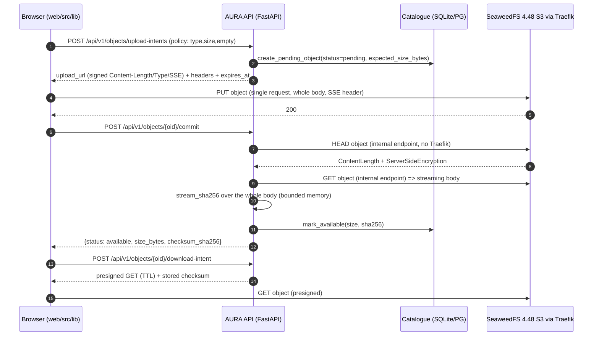
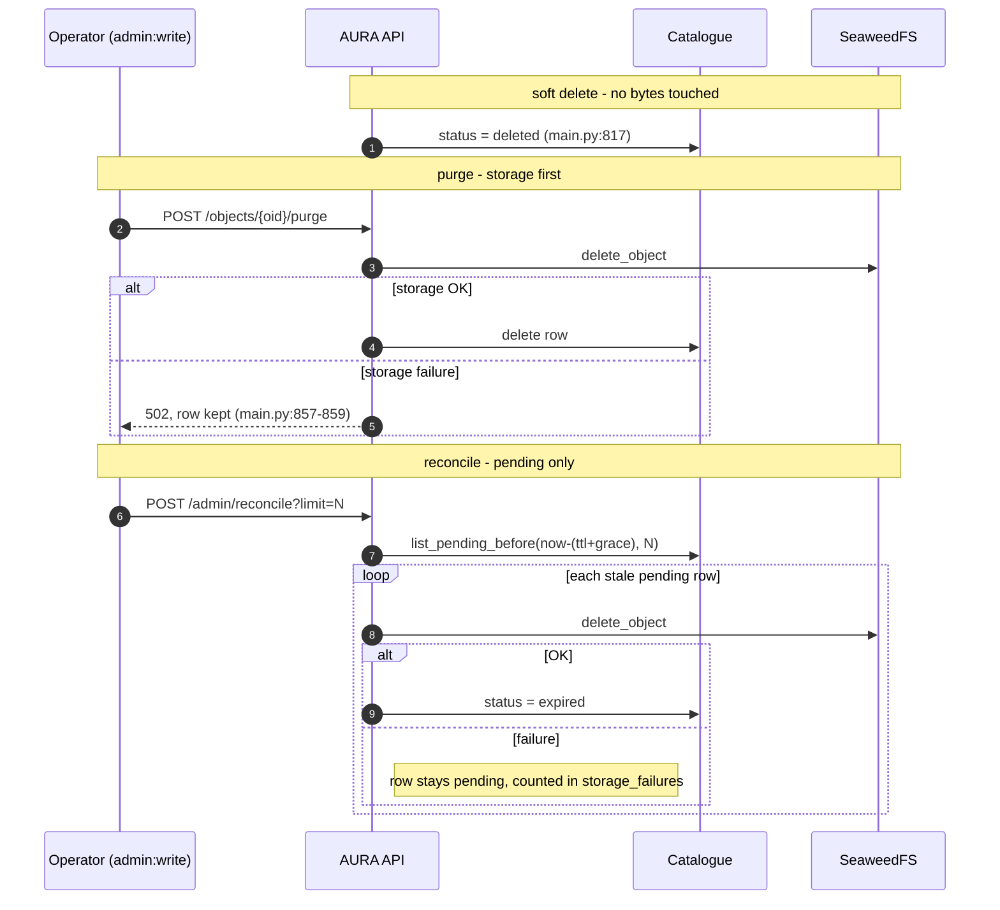

# Transfer engine — evidence-based audit and formal specification (ENG-01 / #82)

**Branch:** `feat/transfer-engine` (base `main` = `ed1d4b6`) · **Date:** 2026-10-20
**Scope of this document:** audit + formal specification only. No code change, no test
change, no commit, no deployment (issue #82 gate: *"Aucun code spéculatif n'est ajouté
avant la spécification"*).

**Relation to the earlier summary:** `docs/engineering/82-transfer-engine-audit.md` (2026-10-15,
83 lines) is the first short audit of the same engine. It is kept, not superseded: this
document extends it (52 capabilities instead of 21, transition matrix, failure analysis,
liveness/invariant analysis, SeaweedFS 4.48 limits measured in
[`multipart-compat-4.48.md`](multipart-compat-4.48.md)). Where the two disagree, this file
wins and the disagreement is listed in §8.

**Résumé (FR).** Chaîne upload vérifiée à la lecture du code et par la suite hors-ligne
(`250 passed, 2 skipped`) : intent persistée → PUT présigné signé (Content-Length, type,
SSE) → commit qui **relit** l'objet en interne et calcule le SHA-256 → `available` →
download/delete/purge → balayage manuel `pending`. Aucune fonctionnalité multipart/Range.
Trois lacunes dominent : (1) **aucune revérification après `available`** — l'URL de PUT
reste valide et les octets peuvent être remplacés sous un catalogue qui garde l'ancien
SHA-256 (`api/main.py:662-668`) ; (2) **aucun balayage des octets orphelins** — les états
`failed`/`aborted`/`deleted`/replay retiré ne sont sélectionnés par aucun sweep
(`api/lifecycle.py:28`, `api/main.py:1111`) et rien ne déclenche le reconcile
automatiquement ; (3) le **contrôle de taille** repose uniquement sur le
`Content-Length` signé, `expected_size_bytes` n'est jamais comparé au commit
(`api/main.py:654-721`).

**Method.** Every material statement below cites code or a test. A claim that only exists
in `docs/*.md` is recorded as UNKNOWN or as a *documented* claim, never as verified
behaviour. Inferences are labelled **INFERRED** with the code they rest on.
Verdict vocabulary: **VERIFIED** (code read *and* a relevant executed test — offline
tests only, see §7), **PARTIAL** (partially covered / one backend or one side only),
**ABSENT** (no implementation), **UNKNOWN** (no evidence obtainable in this environment).

---

## 1. Traced flows

### 1.1 Upload: `upload-intent → presigned URL → object transfer → commit → integrity check → catalogue publication`

| # | Step | Code | Notes |
|---|---|---|---|
| 1 | Authentication + scope | `api/main.py:541` `authorize(OBJECTS_WRITE)` (`api/authz.py:26`) | Session+CSRF for humans, Bearer for services |
| 2 | Space disabled check | `api/main.py:544-549` | A disabled space refuses new intents, keeps reads |
| 3 | Transfer policy (type/size/empty) | `api/main.py:551-562` → `api/transfer.py:69-89` | 422 before any row or URL exists |
| 4 | Idempotency key validation | `api/main.py:564-568` → `api/transfer.py:92-101` | opaque, ≤ `AURA_IDEMPOTENCY_KEY_MAX` |
| 5 | Bucket resolution (space-scoped) | `api/main.py:570-580` → `repo.get_bucket_for_space` / `get_default_bucket` | unregistered bucket = 403; no bucket = 409 |
| 6 | Replay of a live idempotency key | `api/main.py:586-611` | returns the **same row** + a freshly signed URL |
| 7 | Pending backlog cap | `api/main.py:616-617` → `repo.count_pending` (`api/db.py:447`) | 429 above `AURA_MAX_PENDING_INTENTS` |
| 8 | Folder ownership (optional) | `api/main.py:619-625` | human-only, owner-scoped |
| 9 | Server-generated key | `api/main.py:628` `aura/<space>/<actor>/<uuid4>` | client can never choose bucket/key/owner (`api/main.py:313-325`) |
| 10 | Catalogue row `pending` | `api/main.py:630-637` → `repo.create_pending_object` (`api/db.py:388-409`, `api/db_pg.py:351-372`) | persisted **before** the URL is signed |
| 11 | Presigned PUT | `api/main.py:638-640` → `api/s3.py:47-79` | SigV4 over bucket+key, `ContentType`, `ContentLength`, `ServerSideEncryption=AES256` |
| 12 | Response to client | `api/main.py:645-651` (+ `_upload_headers` `api/main.py:533-535`) | `upload_url`, signed `headers`, `expires_at` |
| 13 | Bytes move browser → S3 | `web/src/lib/api.ts:902` `putToPresignedUrl` (XHR); `web/src/lib/transfer.ts:243-252` | bytes never traverse FastAPI |
| 14 | Commit called | `web/src/lib/transfer.ts:253-256` → `POST /api/v1/objects/{oid}/commit` | `validating` phase |
| 15 | Idempotent short-circuit | `api/main.py:662-668` | `available` → returns the stored size + SHA-256, **no storage call** |
| 16 | State machine guard | `api/main.py:669-670` | anything but `pending`/`available` = 409 |
| 17 | Intent death check | `api/main.py:672-676` | past `expires_at + AURA_INTENT_GRACE_SECONDS` → row `expired`, 410 |
| 18 | Storage `HEAD` | `api/main.py:678-681` (via `s3ops` = internal endpoint) | missing/unreachable → 422, row stays `pending` |
| 19 | Size ceiling re-check | `api/main.py:683-688` | `> AURA_MAX_OBJECT_BYTES` → row `failed`, 413 |
| 20 | Encryption-at-rest check | `api/main.py:689-698` | not `AES256` → row `failed`, best-effort delete, 422 |
| 21 | Full re-read + SHA-256 | `api/main.py:700-709` → `api/s3.py:135-148` `stream_sha256` | streaming, 1 MiB chunks, raises `ObjectTooLarge` |
| 22 | Length cross-check | `api/main.py:711-714` | streamed total ≠ `HEAD` length → row `failed`, 422 |
| 23 | Publication | `api/main.py:716` → `repo.mark_available` (`api/db.py:469-474`, `api/db_pg.py:427-431`) | only here does `available` exist |
| 24 | Audit event | `api/main.py:717` | ids/sizes only, never a URL (`api/main.py:601,641,675,697`) |

### 1.2 Download

`POST /api/v1/objects/{oid}/download-intent` (`api/main.py:866-884`): scope check
(`_object_scope`, `api/main.py:218-223`) → **404** if not visible → **409** unless
`status == "available"` (`:873-874`) → presigned GET (`api/s3.py:109-128`, TTL =
`AURA_INTENT_TTL`) → response carries `display_name`, `content_type`, verified
`size_bytes`, `checksum_sha256` (`:877-884`). Preview is the same shape with
`ResponseContentDisposition=inline` + the object's content type (`api/main.py:887-913`).
The API never proxies the bytes. **No `Range` handling anywhere**: a case-sensitive
`grep -rn "Range" api/*.py web/src/lib/*.ts` returns nothing (only the lowercase words
"range"/"ranges" appear in unrelated comments, e.g. `api/config.py:72`, `api/main.py:552`).

### 1.3 Delete (soft) and purge (destructive)

- Soft delete `DELETE /api/v1/objects/{oid}` (`api/main.py:808-819`): 409 unless
  `available` **or `pending`** (`:815`), then `status = 'deleted'` (`:817`).
  **Bytes are not touched**: they survive until purge.
- Purge `POST /api/v1/objects/{oid}/purge` (`api/main.py:848-863`, `objects:purge`):
  `purge_object` (`api/lifecycle.py:47-65`) deletes the bytes **first** (`:61`) then the
  row (`:64`); a storage failure raises `StorageDeleteError` → 502 and the row is kept
  (`api/main.py:857-859`). Note there is **no status guard**: `purge_object` fetches any
  row for the scope (`api/lifecycle.py:56-59`), so `pending`/`failed`/`expired` rows are
  also purgeable — which is today the only cleanup for them.

### 1.4 Reconciliation

`POST /api/v1/admin/reconcile` (`api/main.py:1084-1097`, `admin:write`) →
`reconcile_pending` (`api/lifecycle.py:13-44`):

1. window derived from the same settings that govern intent death:
   `expire_after_s = intent_ttl + intent_grace_s` (`api/main.py:1094`);
2. candidates = `repo.list_pending_before(cutoff, limit)` — `status='pending' AND
   created_at < cutoff ORDER BY created_at ASC LIMIT ?` (`api/db.py:476-481`,
   `api/db_pg.py:433-438`);
3. per row: `s3ops.delete_object` **first**; on exception the row is left `pending` and
   counted in `storage_failures` (`api/lifecycle.py:31-36`);
4. only then `repo.set_status(row["id"], "expired")` (`api/lifecycle.py:38`).

`GET /api/v1/admin/orphans` (`api/main.py:1100-1125`, `admin:read`) is a **read-only**
scan of `available` rows (`repo.list_available`, `api/db.py:483-489`) whose `HEAD`
fails; nothing is deleted on that signal (`api/main.py:1115-1123`).

**Nothing in the repository calls `reconcile_pending` except the admin route and tests**
(`grep -rn reconcile` over `*.py *.sh *.yml *.conf` and the Compose/scripts tree: no
cron, no timer, no startup task). See L1 in §5.

---

## 2. Formal model

### 2.1 Object state model (as implemented)

```mermaid
stateDiagram-v2
    [*] --> pending : upload-intent (main.py:630)
    pending --> available : commit verifies size+SHA-256 (main.py:716)
    pending --> failed : oversize 413 / not-AES256 422 / short read 422 / size mismatch 422
    pending --> expired : commit past grace 410 (main.py:674); replay retires old row (main.py:614); reconcile sweep (lifecycle.py:38)
    pending --> aborted : abort (main.py:758)
    pending --> deleted : soft delete (main.py:817)
    available --> deleted : soft delete (main.py:817)
    deleted --> purged : purge, bytes first then row (lifecycle.py:61,64)
    available --> purged : purge (no status guard, lifecycle.py:56-65)
    pending --> purged : purge (no status guard)
    failed --> purged : purge only (no other route accepts failed: main.py:669,742-746,815)
    expired --> purged : purge only
    aborted --> purged : purge only
    available --> available : repeated commit short-circuit (main.py:662-668)
    pending --> pending : storage outage at commit/HEAD (main.py:680-681)
    state available {
        [*] bytes_carry_the_stored_sha256
    }
    note right of available
        Bytes behind an available row are NOT immutable:
        the PUT URL stays valid until the intent TTL
        and no re-verification happens (main.py:662-668).
        This is a MISSING invariant, not a supported transition.
    end note
```



`purged` is not a stored status: the row is deleted (`repo.delete_object_row`,
`api/lifecycle.py:64`). Status vocabulary: `api/transfer.py:12-17`
(`pending/available/failed/expired/aborted/deleted`) plus the route-level answer
`{"status": "purged"}` (`api/main.py:863`).

### 2.2 Transition matrix (allowed transitions, guards, evidence)

| From → To | Trigger | Guard / code | Test evidence |
|---|---|---|---|
| ∅ → `pending` | `POST /objects/upload-intents` | policy OK, bucket resolved, cap OK — `api/main.py:555-637` | `test_api.py:258-277`, `test_transfer_engine.py:131-154` |
| `pending` → `pending` (replay) | same `Idempotency-Key` while `now ≤ expires_at + grace` | `api/main.py:586-611` | `test_transfer_engine.py:386-399`, `test_sse_at_rest.py:90-99` |
| `pending` → `available` | `commit` | `status == pending`, not past grace, `HEAD` OK, size ≤ cap, `AES256`, streamed total == HEAD size — `api/main.py:669-716` | `test_transfer_engine.py:131-154`, `test_commit_streaming.py:101-118` |
| `available` → `available` | `commit` again | short-circuit, **no storage call** — `api/main.py:662-668` | `test_transfer_engine.py:291-301`, `test_commit_streaming.py:121-129` |
| `pending` → `failed` | `commit`: oversize / not AES256 / unreadable / `ObjectTooLarge` / size mismatch | `api/main.py:686-688`, `:689-698`, `:705-709`, `:711-714` | `test_transfer_engine.py:230-237`, `:254-270`, `test_sse_at_rest.py:102-122`, `test_commit_streaming.py:132-156` |
| `pending` → `expired` | `commit` past `expires_at + grace` | `api/main.py:672-676` | `test_transfer_engine.py:276-285`, `test_commit_streaming.py:159-166` |
| `pending` → `expired` (replay path) | replay arrives past grace: the previous row is retired | `api/main.py:612-614` — **bytes not deleted** | none (no test asserts the byte consequence) |
| `pending` → `expired` | `admin/reconcile` sweep | bytes deleted first — `api/lifecycle.py:31-38` | `test_api.py:346-385`, `test_m06_isolation_matrix.py:404-442` |
| `pending` → `aborted` | `abort` | `status == pending` — `api/main.py:745-758` | `test_transfer_engine.py:344-358` |
| `pending` → `deleted` | soft delete | both statuses allowed — `api/main.py:815-817` | none specific to `pending` (`test_api.py:465-479` uses `pending`) |
| `available` → `deleted` | soft delete | `api/main.py:815-817` | `test_api.py:317-343` |
| `*` → row deleted (`purged`) | `purge` | any status; bytes first, failure → 502 + row kept — `api/main.py:848-863`, `api/lifecycle.py:47-65` | `test_api.py:317-343`, `test_m06_isolation_matrix.py:385-401` |
| `expired`/`aborted` → `pending` | — | **no code path**; `commit` after expiry = 409 | `test_transfer_engine.py:285`, `:358` |
| `failed` → anything but purge | — | 409 at `commit` (`:669`), 409 at `abort` (`:742-746`), 409 at delete (`:815`) | implied by those three tests |

Transitions **absent by design** (no code, listed so the spec is explicit): any
`available → pending`, any resurrect, a second commit that re-verifies bytes, a
`fail → retry` route, a `deleted → available` restore, a per-part state (multipart).

### 2.3 Sequence — upload + commit happy path



### 2.4 Sequence — delete/purge and reconciliation



---

## 3. Failure analysis

### F1. Crash (API container/worker dies mid-flight)

- **After the PUT, before commit** — the row is `pending` (`api/main.py:630`), the bytes
  exist, nothing is lost. Today nothing recovers it automatically: it becomes `expired`
  only when an operator calls `POST /admin/reconcile` (L1). The 8 concurrent-commit test
  (`test_transfer_engine.py:304-338`) is *in-process*, so it does not exercise a hard
  worker death.
- **Inside commit, after the bytes were read, before/at `mark_available`** — the row stays
  `pending` and a later commit re-verifies the same bytes. `mark_available` is a single
  `UPDATE ... WHERE id = ?` (`api/db.py:469-474`) with no status predicate; **INFERRED**
  from that (plus a single shared connection, `api/dblock.py:21-38`): a crash cannot
  produce a half-written row, only "not yet marked".
- **Evidence of no false success on a catalogue failure**: `test_transfer_engine.py:587-606`
  monkeypatches `mark_available` to raise and asserts HTTP 500 **and** the row still
  `pending` — i.e. an `available` claim is never returned without the catalogue write.
- **Unproven**: restart/`SIGKILL` scenarios, and whether the threadpool worker blocked in a
  storage read is reclaimed. `make_client` (`api/s3.py:21-29`) configures **no** timeouts,
  so botocore defaults apply — **INFERRED**: a stalled read holds a worker until the
  socket-level timeout; there is no task-level deadline for commit.

### F2. Ambiguous timeout (S3 stored the object, the API response was lost)

- The client retries `commit` (`web/src/lib/transfer.ts:272-278` treats 5xx/timeouts as
  retryable) and the short-circuit (`api/main.py:662-668`) returns the already-computed
  digest — idempotent by construction, proven for two sequential calls
  (`test_transfer_engine.py:291-301`). If the first commit never got to
  `mark_available`, the retry re-runs the full verification (safe, just slow).
- **Unproven**: a *real* dropped response across the network (the tests are
  `TestClient`-based), and the same scenario on PostgreSQL.
- **Related timing hazard (INFERRED, no measurement here)**: the app→api hop has **no**
  `proxy_read_timeout` (`app/nginx.conf:24-30`), so nginx's default 60s idle timeout
  applies to the commit *response* while the API may spend minutes hashing up to 5 GiB
  (`api/main.py:700-704`). A client could see 504 while the API still marks the row
  `available`; the retry then converges to `available` (`:662`). Not observed, not tested.

### F3. Concurrent commit (same pending object, N clients)

- Covered offline **only** for identical bytes: 8 threads → all 200, one digest
  (`test_transfer_engine.py:304-338`, SQLite, via the repository lock).
- **Structural gap**: commit is *check-then-act*. The status read (`api/main.py:657-670`)
  and the write (`mark_available`, `api/db.py:469-474`) are not atomic, and
  `mark_available`/`set_status` carry **no status predicate**
  (`api/db.py:491-496`, `api/db_pg.py:448-452`). The repository lock only serializes
  individual calls; it does not make the read-modify-write atomic. With a non-constant
  body, the last writer wins on `size_bytes`/`checksum_sha256` — **INFERRED** from those
  lines; not exercised by any test (the stub returns constant bytes).
- Same shape for `abort` vs `commit` (`api/main.py:735-758`) and `delete` vs `commit`
  (`:811-817`): an interleaved `set_status(aborted/deleted)` after a concurrent
  `mark_available` is possible; no test, no CAS, no row version.

### F4. Expired URL / expired intent

- **Commit after `expires_at + grace`**: row → `expired`, HTTP 410, terminal
  (`api/main.py:672-676`; `test_transfer_engine.py:276-285`).
- **Presigned URL itself expired**: the gateway rejects it (403) — a *documented* live
  measurement of the URL TTL exists in the test suite but is **skipped here**
  (`test_api.py:451-462`, skipped at `:409`). The web client classifies 403 as `expired`
  and refreshes the intent, bounded by `maxIntentRefreshes: 2`
  (`web/src/lib/transfer.ts:55-63,121-139,262-271`) — read, not executed here.
- **Usability defect found by reading the code (not tested)**: on replay the API returns
  the **original** `expires_at` (`api/main.py:592,610`) while the URL it just signed lives
  for another `AURA_INTENT_TTL` (`:597-600`). A replay accepted at the edge of the grace
  window therefore hands out a URL whose commits are rejected with 410
  (`:673-676`) for most of its remaining life. No test covers the edge; **INFERRED** from
  the two lines.

### F5. PostgreSQL ↔ S3 divergence

- No distributed transaction; the only defence is **ordering**:
  delete-bytes-then-row (`api/lifecycle.py:60-64`) and delete-bytes-then-`expired`
  (`api/lifecycle.py:31-38`). Both directions are exercised offline (storage failure
  paths: `test_m06_isolation_matrix.py:385-442`).
- **Unhandled divergences (ABSENT, verified by absence of code)**:
  1. *storage object without a row*: retired replay intent (`api/main.py:612-614`),
     `abort` with a failed delete (`api/main.py:748-757`), oversized commit
     (`api/main.py:686-688`) and size-mismatch commit (`:711-714`) — the last two mark the
     row `failed` **without deleting bytes**, unlike the SSE branch (`:692-696`);
     soft-deleted rows (bytes kept until purge, `api/main.py:817`). No sweep selects
     `failed`/`aborted`/`deleted` (`api/lifecycle.py:28`), and `/admin/orphans` scans only
     `available` (`api/main.py:1111`) — so these bytes are invisible to every automated
     check. The code itself documents the abort case as manual (`api/main.py:750-757`).
  2. *row without bytes* for non-`available` statuses: not scanned at all.
  3. **No object versioning / object-lock / retention configuration** in the stack
     (`docker-compose.yml:153-195`; no versioning flag, no bucket policy) — **INFERRED**:
     a PUT overwrites, it does not create a version.

---

## 4. SeaweedFS 4.48 and edge-proxy compatibility limits (explicit)

| Limit | Status in AURA | Evidence |
|---|---|---|
| **Single-PUT shape only.** One request carries the whole object; the signed `Content-Length` is the size contract. | Implemented; the only supported shape | `api/s3.py:47-79`; `api/main.py:638-640`; `AURA_MAX_OBJECT_BYTES` default 5 GiB = the backend single-PUT ceiling (`api/config.py:84-88`, `docker-compose.yml:268`) |
| **No multipart in AURA today.** No `CreateMultipartUpload`/`UploadPart`/`Complete`/`Abort`/`ListParts` call exists in `api/`. | ABSENT | `grep -rln "multipart\|upload_part\|create_multipart" api/*.py` → only a comment in `api/config.py:84-87` |
| **Part semantics (≥5 MiB only at Complete, part ETag = MD5, SSE inherited server-side, presigned part URLs)** | NOT verified on 4.48 | Research note only (`.slim/deepwork/transfer-engine/progress.md:33`); gate not run (`docs/TRANSFER-ENGINE.md:157-160`); the lane-B probe harness is uncommitted WIP at the time of writing (`tests/multipart_compat_client.py`, `tests/multipart-compat-4.48.sh`) |
| **Multipart ETag ≠ full-object hash** | Rule already honoured: AURA computes SHA-256 itself and never treats ETag as a checksum | `api/main.py:700-716`, `api/s3.py:135-148`; `grep -rn "ETag" api/*.py` → no match; `docs/TRANSFER-ENGINE.md:92-104` |
| **`Range` GET / resumable download** | ABSENT | `api/main.py:866-913` (plain presigned GET); no `Range` in `api/`; no `Range` in `web/src/lib/transfer.ts` |
| **Traefik `readTimeout` = 1200 s on the `websecure` entrypoint** (all presigned PUT/GET go through it: `aura-s3` router). | Configured in Compose | `docker-compose.yml:16-20`, `:185-193` |
| Consequence of the above (arithmetic, **INFERRED** from `api/config.py:88` + `docker-compose.yml:20`): a 5 GiB single PUT must sustain ≈ **4.3 MiB/s** (5 GiB / 1200 s), else the proxy cuts the body mid-request. | Derived constraint | Same two lines |
| The API's commit re-read is **not** subject to Traefik: `s3ops` uses `AURA_S3_INTERNAL_ENDPOINT` (`http://seaweed-filer:8333`) | Verified by wiring | `api/main.py:149-152`, `api/s3.py:32-38`, `api/config.py:30-32`, `docker-compose.yml:236`; the `api` service has no Traefik route (`docker-compose.yml:297`) |
| The app→api hop has no proxy timeout configured → nginx default 60 s idle on the commit response | ABSENT (risk) | `app/nginx.conf:24-30`; **INFERRED** (nginx default), not measured |
| Pinned image tag `chrislusf/seaweedfs:4.48` | Documented, not resolvable from the repo | Image comes from `${SEAWEEDFS_IMAGE}` (`docker-compose.yml:115`, `:132`, `:154`); `.env` is git-ignored; the tag is asserted in `docs/engineering/VALIDATION-REGISTER.md:15`, `docs/TRANSFER-ENGINE.md:114`, `docs/SECURITY.md:24` |

**Documented-but-not-reproduced live measurement** (must not be read as verified here):
throttled PUTs on the pilot cut at 60 s in the *request* direction only, downloads >60 s
completing — `docs/MULTIPART-UPLOAD-PLAN.md:24-47`. That table is the origin of the
1200 s setting; this audit did not reproduce it (no endpoint may be contacted).

---

## 5. Safety invariants, liveness assumptions

### Safety invariants upheld (code + executed test)

| # | Invariant | Evidence |
|---|---|---|
| S1 | `available` requires a full SHA-256 computed over the bytes plus a size equality check | `api/main.py:700-716`; `test_transfer_engine.py:131-154`, `test_commit_streaming.py:101-118` |
| S2 | No `available` for an object the storage does not report as `AES256` (when `AURA_REQUIRE_SSE=1`) | `api/main.py:689-698`; `test_sse_at_rest.py:102-122` |
| S3 | A storage failure never yields success and never drops a catalogue reference | `api/main.py:680-681`, `api/lifecycle.py:32-36`, `:62-64`; `test_transfer_engine.py:243-251`, `test_m06_isolation_matrix.py:385-442` |
| S4 | Destructive ordering is storage-first (purge, reconcile) | `api/lifecycle.py:31-38`, `:60-64` |
| S5 | Every transfer route is space-scoped, owner-scoped for humans; foreign/unknown ids are 404 (no existence oracle) | `api/main.py:218-223` used at `:657,:735,:811,:869,:896`; `test_transfer_engine.py:473-493`, `test_m06_isolation_matrix.py:155-224` |
| S6 | Keys/bucket/owner are server-generated; the client cannot steer them | `api/main.py:313-325`, `:628`; `test_security_isolation.py:128-142` |
| S7 | No secret, key or presigned URL in responses or the audit log | `api/main.py:291-304`, `:645-651`; `test_transfer_engine.py:565-581`, `test_api.py:113-139,258-277` |
| S8 | Intent death is monotone: `expired`/`aborted` never return to `pending` | no code path; `test_transfer_engine.py:285`, `:358` |
| S9 | Commit never publishes an object whose stored length differs from the read length | `api/main.py:711-714`; `test_transfer_engine.py:263-270` |

### Missing invariant (found by this audit, to be specified before code)

| # | Desired invariant | Status |
|---|---|---|
| **S10** | *The bytes behind an `available` row always hash to that row's `checksum_sha256`.* | **NOT upheld.** `commit` short-circuits on `available` without touching storage (`api/main.py:662-668`), the PUT capability stays valid until the intent TTL (`api/s3.py:47-79`), and nothing revokes it after publication. A second PUT to the same key with the same signed `Content-Length` can therefore replace the bytes while the catalogue keeps the old digest (see F3/S10 and gap G1). Exploitability on 4.48 is **UNKNOWN** here (needs a live probe); the *absence of any re-verification or revocation* is VERIFIED by the code. |

### Liveness assumptions (all are assumptions; only #5 has a test)

| # | Assumption | Reality today |
|---|---|---|
| L1 | Something periodically runs the reconciliation sweep | **Nothing does.** Only the admin route exists (`api/main.py:1084`); no scheduler, cron, timer or compose task anywhere in the repo (`grep -rn reconcile`). Intents stay `pending` indefinitely. |
| L2 | The gateway enforces the signed `Content-Length`/`Content-Type`/SSE headers | Unverified offline: the only assertion is that they are *signed* (`test_transfer_engine.py:156-195`); the live check is skipped (`test_api.py:409`). The code says so itself (`api/s3.py:66-67`). |
| L3 | The client retries `commit` after a lost response | Client-side only (`web/src/lib/transfer.ts:272-278`); not executed here. |
| L4 | The storage delete eventually succeeds on retry | True only for reconcile (retried by the next sweep). `abort` (`api/main.py:748-757`), oversized and size-mismatch commits (`:686-688`, `:711-714`) have **no** retry path. |
| L5 | An upload completes inside the 1200 s proxy window | Derived: needs ≈4.3 MiB/s at the 5 GiB ceiling (§4). |
| L6 | A long commit is not cut by the app→api proxy | No timeout configured (`app/nginx.conf:24-30`) → nginx default 60 s idle applies (**INFERRED**). |
| L7 | A stalled storage read cannot pin a worker forever | No timeouts in the S3 client (`api/s3.py:21-29`); botocore defaults only (**INFERRED**). |

---

## 6. Capability classification (VERIFIED / PARTIAL / ABSENT / UNKNOWN)

Verdicts are per *capability as it must work in production*. **Offline-only evidence caps a
verdict at VERIFIED (offline)** — live behaviour is UNKNOWN unless the live test was
actually executed, which it was not (both live/parity tests were skipped, §7).

| # | Capability | Verdict | Evidence (code, then test) |
|---|---|---|---|
| 1 | Intent row persisted before the URL is signed | VERIFIED | `api/main.py:630-640`; `test_transfer_engine.py:131-154`, `test_api.py:258-277` |
| 2 | Server-chosen key/bucket/owner; client cannot inject them | VERIFIED | `api/main.py:313-325,570-580,628`; `test_security_isolation.py:128-142` |
| 3 | Server-side policy: media-type allow-list, size cap, empty-file rule | VERIFIED | `api/transfer.py:69-89`, `api/main.py:551-562`; `test_transfer_engine.py:200-236,429-454` |
| 4 | Declared size kept distinct from the verified size (`expected_size_bytes`) | PARTIAL | stored/exposed `api/migrations.py:61`, `api/db.py:393-406`, `api/db_pg.py:356-370`, `api/main.py:298`; **never compared at commit** (`api/main.py:654-721`) |
| 5 | `Idempotency-Key` replay returns the same row + fresh URL | VERIFIED | `api/main.py:586-611`, `api/db.py:455-467`; `test_transfer_engine.py:386-423`, `test_sse_at_rest.py:90-99` |
| 6 | Replay never extends intent death (returns the original `expires_at`) | VERIFIED (code) | `api/main.py:592-614`; no test at the grace edge (usability defect, F4) |
| 7 | Pending-backlog cap per scope | PARTIAL | `api/main.py:616-617`, `api/db.py:447-453`; **no test** (only the limit is *read* back in `test_m07_observability.py:286`) |
| 8 | Presign binds bucket, key, `Content-Type`, `Content-Length`, SSE header | VERIFIED (presigning) | `api/s3.py:47-79`, `api/main.py:533-535,638-640`; `test_transfer_engine.py:156-195`, `test_api.py:280-294` |
| 9 | The gateway **enforces** those signed headers | UNKNOWN | offline stubs only; live test skipped `test_api.py:409-462`; claim in `api/s3.py:66-67` + `docs/SECURITY.md:24` |
| 10 | Presigned GET for download and inline preview, metadata + stored checksum | VERIFIED | `api/s3.py:109-128`, `api/main.py:866-913`; `test_transfer_engine.py:503-542` |
| 11 | No credentials/URLs leaked to browser, response or audit trail | VERIFIED | `api/main.py:291-304,645-651`; `test_transfer_engine.py:565-581`, `test_api.py:113-139` |
| 12 | `available` only after full SHA-256 + size equality | VERIFIED | `api/main.py:700-716`; `test_transfer_engine.py:131-154`, `test_commit_streaming.py:101-118` |
| 13 | Hash computed by **re-reading the object server-side** (internal endpoint, no Traefik) | VERIFIED | `api/main.py:700-704` + `api/main.py:149-152`, `api/s3.py:32-38`, `api/config.py:30-32`; `test_commit_streaming.py:101-118` |
| 14 | Bounded-memory hashing (1 MiB chunks, early abort past the cap) | VERIFIED | `api/s3.py:131-148`; `test_commit_streaming.py:116-118` |
| 15 | Oversize/inconsistent object → `failed`, never `available` | VERIFIED | `api/main.py:686-688,705-714`; `test_transfer_engine.py:230-237,263-270`, `test_commit_streaming.py:144-156` |
| 16 | Bytes of a rejected commit are cleaned up | **ABSENT** | only the SSE branch deletes (`api/main.py:689-698`); oversize (`:686-688`) and mismatch (`:711-714`) leave the bytes; no sweep selects `failed` (`api/lifecycle.py:28`) |
| 17 | Commit refuses an object not encrypted at rest (SSE-AES256) | VERIFIED (offline) | `api/main.py:689-698`; `test_sse_at_rest.py:102-122` |
| 18 | The stored object is actually encrypted by SeaweedFS | UNKNOWN | live-only evidence (`docs/SECURITY.md:24`, dated pilot logs); not run here |
| 19 | Repeated commit is idempotent (`available` → same digest) | VERIFIED | `api/main.py:662-668`; `test_transfer_engine.py:291-301`, `test_commit_streaming.py:121-129` |
| 20 | Post-publication re-verification of the bytes behind a checksum | **ABSENT** | `api/main.py:662-668` (short-circuit performs no storage call) |
| 21 | Immutability of published bytes (no silent replacement via the live PUT URL) | **ABSENT** as a control / UNKNOWN as exploitability | `api/s3.py:47-79` + `api/main.py:662-668`; no versioning/object-lock in `docker-compose.yml:153-195` |
| 22 | Commit on a never-uploaded object → 422, row stays `pending` | VERIFIED | `api/main.py:678-681`; `test_transfer_engine.py:243-251` |
| 23 | Expired intent → 410 + terminal `expired` | VERIFIED | `api/main.py:672-676`; `test_transfer_engine.py:276-285`, `test_commit_streaming.py:159-166` |
| 24 | Commit refused for `aborted`/`deleted`/`failed`/`expired` | VERIFIED | `api/main.py:669-670`; `test_transfer_engine.py:358`, `test_api.py:336-337` |
| 25 | Abort: best-effort byte delete, idempotent, 409 on `available`/`deleted` | VERIFIED | `api/main.py:724-760`; `test_transfer_engine.py:344-380` |
| 26 | Abort tolerated storage failure: bytes orphaned, never retried | VERIFIED (code) | `api/main.py:748-757`; `test_transfer_engine.py:371-380` asserts 200 but not cleanup |
| 27 | Soft delete is catalogue-only; bytes kept until purge | VERIFIED | `api/main.py:808-819`; `test_api.py:317-343,465-479` |
| 28 | Purge deletes bytes first; storage failure → 502 + row kept | VERIFIED | `api/lifecycle.py:47-65`, `api/main.py:848-863`; `test_api.py:317-343`, `test_m06_isolation_matrix.py:385-401` |
| 29 | Purge usable for any status (incl. stuck `pending`/`failed`) | VERIFIED | `api/lifecycle.py:56-65` (no status guard); `test_api.py:317-343` |
| 30 | Reconcile: stale `pending` → bytes deleted → `expired`; S3 failure keeps `pending` and is counted | VERIFIED | `api/lifecycle.py:13-44`, `api/main.py:1084-1097`; `test_api.py:346-385`, `test_m06_isolation_matrix.py:404-442` |
| 31 | Reconcile window derived from `intent_ttl + grace` (never the default 3600) | VERIFIED | `api/main.py:1094`; `test_m07_observability.py:622-640` |
| 32 | Reconcile is bounded per call, oldest-first, resumable by repetition | PARTIAL | `api/main.py:1088-1095`, `api/lifecycle.py:28`; no cursor/pagination; `test_m07_observability.py:596-619` |
| 33 | Automatic/periodic reconciliation | **ABSENT** | no scheduler anywhere (`grep -rn reconcile` → route + tests only) |
| 34 | Catalogue→storage orphan candidates (read-only, admin) | VERIFIED | `api/main.py:1100-1125`, `api/db.py:483-489`; `test_m07_observability.py:548-593` |
| 35 | Storage→catalogue orphans (object with no row) detection | **ABSENT** | `/admin/orphans` scans only `available` rows (`api/main.py:1111`); no bucket listing in the transfer path |
| 36 | Cleanup of bytes for `failed`/`aborted`/`deleted`/retired-replay rows | **ABSENT** | `api/lifecycle.py:28` (pending only); `api/main.py:614,686-688,711-714,748-757,817` |
| 37 | Concurrent `commit` convergence | PARTIAL | `test_transfer_engine.py:304-338` (SQLite, constant bytes); no CAS: `api/db.py:469-474`, `api/db_pg.py:427-431` |
| 38 | `commit` vs `abort`/`delete`/reconcile races | **ABSENT** | `set_status` has no status predicate (`api/db.py:491-496`, `api/db_pg.py:448-452`); no test |
| 39 | PostgreSQL parity of the transfer surfaces | PARTIAL | static surface pin `test_repository_parity.py:68-80`; live parity **skipped** (`test_pg_parity.py:28`) |
| 40 | Crash / worker restart mid-transfer | UNKNOWN | no test; only inference from `api/main.py:680-681` + `api/lifecycle.py:28` |
| 41 | Ambiguous timeout (stored but response lost) converges | PARTIAL | `api/main.py:662-668`; `test_transfer_engine.py:291-301` (in-process, no real drop) |
| 42 | PG/S3 divergence is auto-healed | PARTIAL | safe ordering only (`api/lifecycle.py:31-38,60-64`); no repair job, no reverse sweep |
| 43 | Single-PUT shape with a 5 GiB ceiling | VERIFIED | `api/config.py:84-88`, `docker-compose.yml:268`, `api/s3.py:47-79`; `test_api.py:296-314` (cap refusal) |
| 44 | Multipart upload | **ABSENT** | no multipart call in `api/`; plan only (`docs/MULTIPART-UPLOAD-PLAN.md`); lane-B harness uncommitted WIP |
| 45 | SeaweedFS 4.48 multipart/Range compatibility | UNKNOWN | probe never run (`docs/TRANSFER-ENGINE.md:157-160`) |
| 46 | `Range`/resumable download | **ABSENT** | `api/main.py:866-913`; case-sensitive `grep -rn "Range" api/*.py web/src/lib/*.ts` → no match |
| 47 | Server-side retry policy for transfers | **ABSENT** | client-only backoff (`web/src/lib/transfer.ts:110-117,216-279`) |
| 48 | Traefik `readTimeout` raised for large single PUTs | VERIFIED (config) / PARTIAL (measurement) | `docker-compose.yml:16-20`; measurement is doc-only (`docs/MULTIPART-UPLOAD-PLAN.md:24-47`) |
| 49 | App→api proxy timeout sized for a long commit response | **ABSENT** | `app/nginx.conf:24-30`; nginx default 60 s idle (**INFERRED**) |
| 50 | Transfer benchmarks / baseline | **ABSENT** | no harness |
| 51 | Frontend transfer state machine (phases, classification, bounded backoff, never-fake-success, URL refresh) | PARTIAL | `web/src/lib/transfer.ts:17-29,110-151,170-284`, `web/src/lib/api.ts:902`; specs exist (`web/e2e/transfer-engine.spec.ts` — 25 `test(`; `upload-flow.spec.ts` — 7) but **not executed here** |
| 52 | Live end-to-end round trip incl. presigned expiry | UNKNOWN | test exists, **skipped**: `test_api.py:409-462` |

**Verdict counts (52 rows, counted mechanically — command in §7):**

| Verdict | Count | Rows |
|---|---|---|
| VERIFIED | **27** | 1,2,3,5,6,8,10,11,12,13,14,15,17,19,22,23,24,25,26,27,28,29,30,31,34,43,48 |
| PARTIAL | **8** | 4,7,32,37,39,41,42,51 |
| ABSENT | **12** | 16,20,21,33,35,36,38,44,46,47,49,50 |
| UNKNOWN | **5** | 9,18,40,45,52 |

Qualifiers are part of the verdict, not of the count: rows 6,8,17,26,48 and 21 carry a
bracket (`(code)`, `(presigning)`, `(offline)`, `**ABSENT** as a control / UNKNOWN as
exploitability`). Rows 17 and 26 are "VERIFIED **offline**": no live run happened, so they
must not be read as production-verified.

---

## 7. Verification performed for this audit (and what was not run)

| Command | Result |
|---|---|
| `AURA_API_ADMIN_PASSWORD=ci AURA_S3_ACCESS_KEY=ci-1234567890 AURA_S3_SECRET_KEY=ci-12345678901234567890 AURA_S3_ENDPOINT=https://127.0.0.1:9 AURA_API_DB=:memory: AURA_COOKIE_SECURE=0 .venv/bin/python -m pytest tests/ -q` | **250 passed, 2 skipped** (107.59 s) |
| `.venv/bin/python -m pytest tests/test_transfer_engine.py tests/test_commit_streaming.py tests/test_sse_at_rest.py -q` | **45 passed** (15.39 s) |
| `.venv/bin/python -m pytest tests/ -q -rs` | skips: `test_api.py:409` (needs `AURA_LIVE_S3=1`), `test_pg_parity.py:28` (needs `AURA_TEST_PG_DSN`) |
| Verdict tally | see the exact command just below; its output must be `27 VERIFIED / 8 PARTIAL / 12 ABSENT / 5 UNKNOWN` |

Exact tally command (re-runnable, no state, no network):

```bash
awk -F'|' '/^\| [0-9]+ \|/ { v=$4; if (v ~ /VERIFIED|PARTIAL|ABSENT|UNKNOWN/) {
  if (v ~ /^ *\*?\*?VERIFIED/) print "VERIFIED";
  else if (v ~ /^ *\*?\*?PARTIAL/) print "PARTIAL";
  else if (v ~ /^ *\*?\*?ABSENT/) print "ABSENT";
  else print "UNKNOWN" } }' docs/engineering/transfer-engine-audit.md | sort | uniq -c
# observed:  12 ABSENT / 8 PARTIAL / 5 UNKNOWN / 27 VERIFIED
```

Note on scope of the tally: it counts the 52 rows of §6 only. §1.1 and §2.2 tables are
numbered separately and deliberately excluded (they describe steps and transitions, not
verdicts). Two rows of §6 (16 and 21) are ABSENT-as-a-control; row 21 also records
UNKNOWN exploitability — the stricter of the two is what the count uses.

**Not run, with reasons**

- Live SeaweedFS (`AURA_LIVE_S3=1`): contacting the pilot VPS is prohibited here
  (`AGENTS.md`, *Hard prohibitions*). So: signed-header enforcement, SSE-at-rest,
  presigned expiry and the whole "live" column are UNKNOWN.
- PostgreSQL parity (`AURA_TEST_PG_DSN`): no disposable PostgreSQL available; the SQLite
  repository is what all the offline evidence exercises. `api/db_pg.py` was read, not run.
- Frontend specs (`web/e2e/transfer-engine.spec.ts`, `web/e2e/upload-flow.spec.ts`): not
  executed for this audit; the frontend verdict rests on reading `web/src/lib/transfer.ts`
  and `web/src/lib/api.ts`.
- `scripts/seaweedfs-compat-probe.py` and the lane-B harness
  (`tests/multipart_compat_client.py`, `tests/multipart-compat-4.48.sh`, uncommitted WIP by
  the parallel lane at the time of writing): not run.
- The readTimeout measurement (`docs/MULTIPART-UPLOAD-PLAN.md:24-47`) was **not**
  reproduced; it is cited as a documented measurement, not as this audit's evidence.

**Working-tree state at audit time** (unchanged by this document): branch
`feat/transfer-engine` at `ed1d4b6`; `.gitignore` modified and `.ignore` untracked
(pre-existing/other lane, not touched here); lane-B artifacts untracked
(`tests/multipart_compat_client.py`, `tests/multipart-compat-4.48.sh`,
`docs/engineering/multipart-compat-4.48.md`). No commit, no push, no code change.

---

## 8. Gap inventory, ordered by risk

| # | Gap | Severity | Evidence | Suggested owner |
|---|---|---|---|---|
| **G1** | **No post-publication integrity control (missing invariant S10).** A published row can keep a stale SHA-256 while the bytes behind it change: commit short-circuits on `available` (`api/main.py:662-668`), the PUT capability stays valid for the full intent TTL (`api/s3.py:47-79`), nothing revokes it, and no versioning/object-lock exists (`docker-compose.yml:153-195`). | P0 (integrity) | `api/main.py:662-668`, `api/s3.py:47-79`; live exploitability UNKNOWN | #83 (server state machine) |
| **G2** | **No automatic reconciliation and no reverse-orphan sweep.** Nothing schedules `reconcile` (route-only); bytes for `failed`/`aborted`/`deleted`/retired-replay rows are selected by no sweep (`api/lifecycle.py:28`) and `/admin/orphans` only looks at `available` rows (`api/main.py:1111`). `pending` can stay `pending` indefinitely. | P0 (divergence, unbounded storage growth) | `api/main.py:614,686-688,711-714,748-757,817,1111`, `api/lifecycle.py:28` | #87 |
| **G3** | **The size contract is enforced only by the gateway's signed `Content-Length`.** `expected_size_bytes` is stored and shown but never compared at commit (`api/main.py:654-721`; only `HEAD` length vs streamed length is checked, `:683,:711`), and that gateway enforcement is UNKNOWN offline (live test skipped). Also: the commit re-read costs a full second pass over up to 5 GiB with no configured timeouts (`api/s3.py:21-29`) behind an app proxy with a 60 s default idle timeout (`app/nginx.conf:24-30`). | P0 (unverified control + large-object timeouts) | `api/migrations.py:61`, `api/db.py:393-406`, `api/main.py:654-721`, `api/s3.py:21-29`, `app/nginx.conf:24-30` | #83 / #86 |
| G4 | Commit is check-then-act with no CAS: `mark_available`/`set_status` carry no status predicate, so `commit` can race `abort`/`delete` and two commits can write different digests for non-constant bytes. | P1 | `api/db.py:469-474,491-496`, `api/db_pg.py:427-431,448-452`; `test_transfer_engine.py:304-338` covers only constant bytes | #83 |
| G5 | `failed`, `aborted` and `deleted` rows are terminal with no cleanup path other than a per-object admin `purge`; oversized/mismatched commits do not even attempt a delete (unlike the SSE branch). | P1 | `api/main.py:686-688,711-714,757,815-817`, `api/lifecycle.py:28` | #87 |
| G6 | Replay can hand out a URL that commits cannot accept (original `expires_at` vs a fresh TTL), and retiring a past-grace replay row drops the reference without deleting its bytes. | P1 | `api/main.py:592-614`; no test | #83 |
| G7 | Reconciler is bounded per call with no cursor; "repeat until 0" is an operator instruction, not a contract. | P2 | `api/main.py:1088-1095`, `api/lifecycle.py:28` | #87 |
| G8 | Multipart / `Range` / part semantics on SeaweedFS 4.48 are unproven; the whole large-file story (5 GiB single request, ≈4.3 MiB/s floor at 1200 s) depends on it. | P2 (blocked by #84 gate) | §4; `docs/TRANSFER-ENGINE.md:157-160`, `docs/MULTIPART-UPLOAD-PLAN.md:66-85` | #84 / #85 |
| G9 | No server-side retry/idempotency policy beyond commit; the only retry logic is client-side. | P2 | `web/src/lib/transfer.ts:110-117,216-279`; no `api/` equivalent | #86 |
| G10 | Minor: `SSE_ALGORITHM`/`SSE_HEADER` are defined three times in `api/s3.py:11-18,41-44` (later definitions win; harmless but confusing). | P3 | `api/s3.py:11-18,41-44` | #83 cleanup |
| G11 | No benchmark/baseline harness, so no tuning decision can be evidence-based. | P3 | none | #88 |

---

## 9. Minimum specification the later phases must honour (contract derived from the code)

1. **State + transitions**: exactly the §2.2 matrix; no transition outside it may be added
   without updating the matrix and a test. `mark_available` and `set_status` must become
   state-predicated (compare-and-set) before any concurrency work (#83).
2. **Integrity**: `available` ⇔ (bytes were read end-to-end by the API) ∧
   (`streamed length == HEAD length`) ∧ (`HEAD SSE == AES256` when required) ∧
   (the SHA-256 that was just computed is what the row stores). Anything that can change
   the bytes after that point must either be impossible (revoke/rotate the capability,
   object-lock) or must invalidate the checksum — S10 is the missing invariant (#83).
3. **Divergence**: every path that abandons bytes must be enumerable by a sweep, and every
   sweep must be idempotent and bounded. Concretely: a reverse sweep (storage → catalogue)
   and coverage of `failed`/`aborted`/`deleted`, or a documented, per-status cleanup
   contract (#87).
4. **Reconciliation**: the derived window (`intent_ttl + grace`) stays the contract; a
   scheduler (or a documented, externally-owned trigger) must exist before
   "abandoned uploads are reconciled" is claimed anywhere (#87, `docs/FILE-TRANSFER.md:90`).
5. **Limits**: single-PUT ≤ 5 GiB with a signed `Content-Length`; ≥ ~4.3 MiB/s at the
   1200 s proxy window for a 5 GiB PUT; multipart only after the 4.48 gate is recorded
   (≥5 MiB part semantics at Complete, ETag ≠ SHA-256) (#84/#85).
6. **Evidence rule**: a capability is only VERIFIED when a test that can actually run in
   the environment supports the claim. Offline-only evidence stays "VERIFIED (offline)"
   and the live column stays UNKNOWN until the pilot runs are recorded in
   `docs/verification-log-template.md` style logs.
